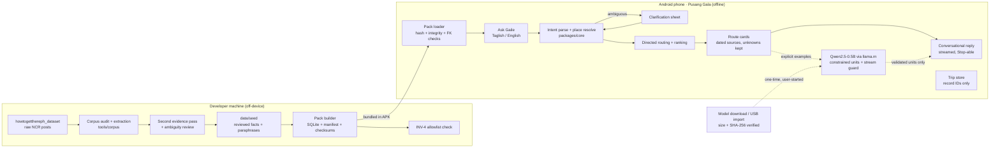
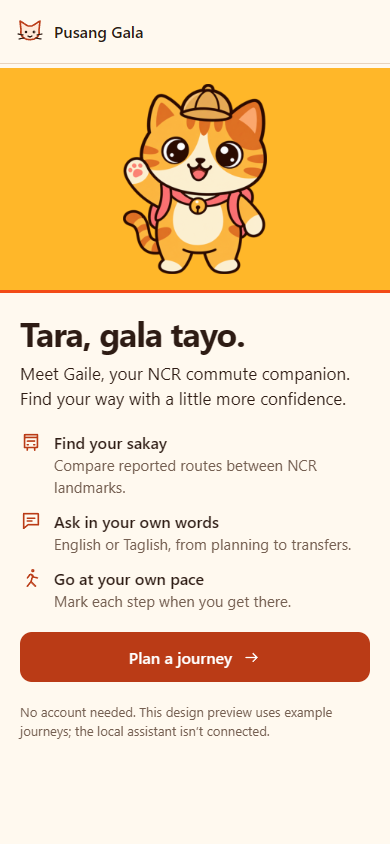
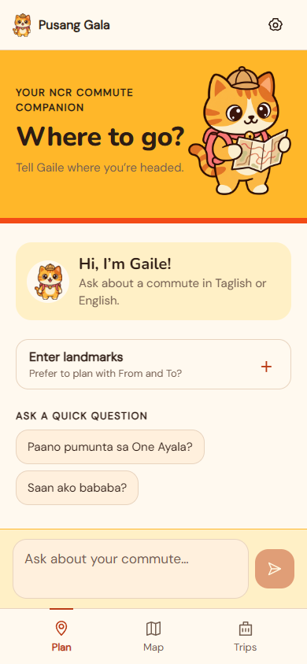
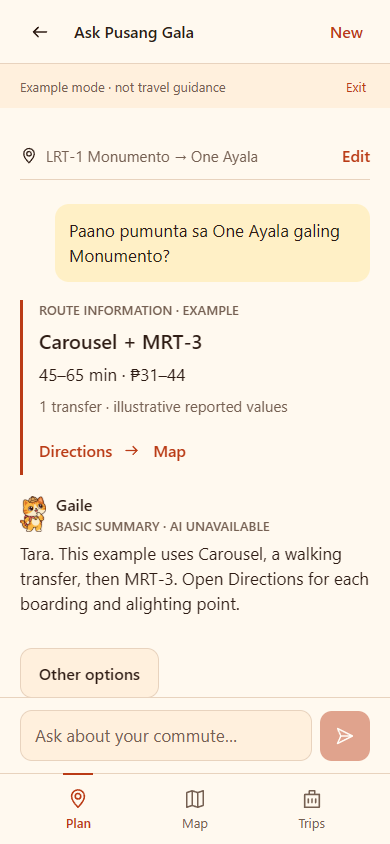
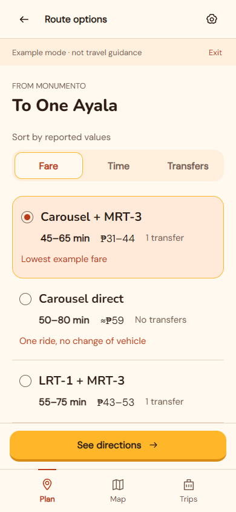
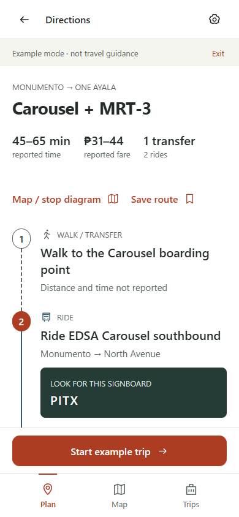
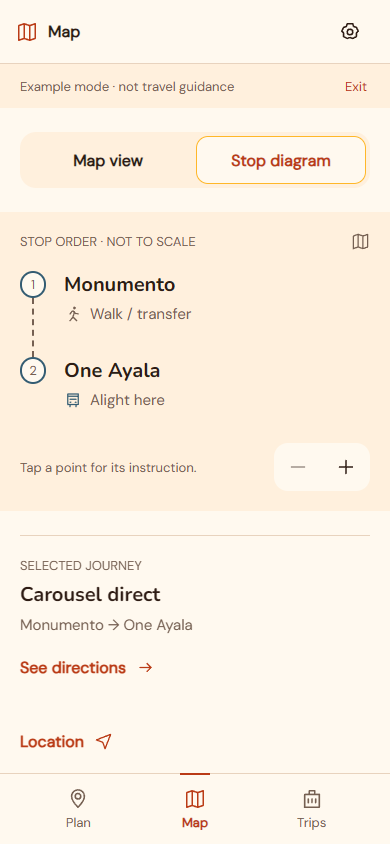
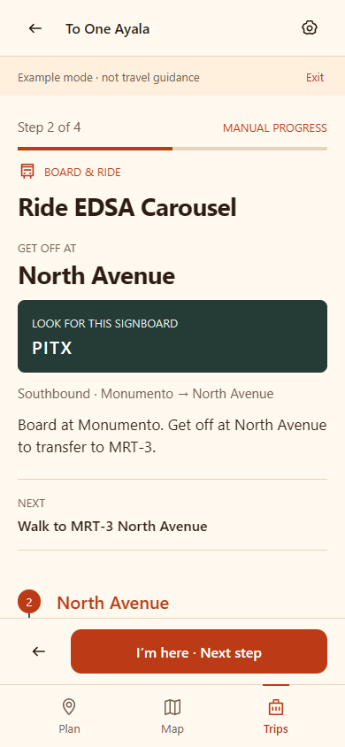
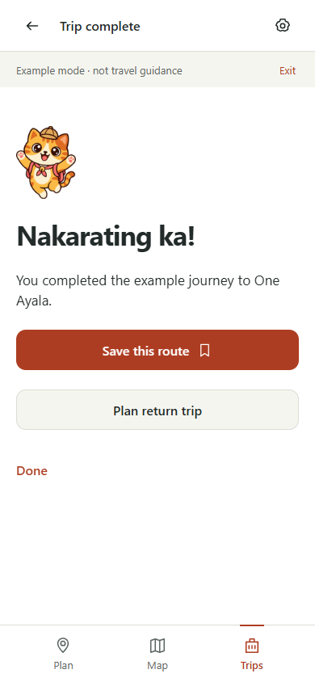
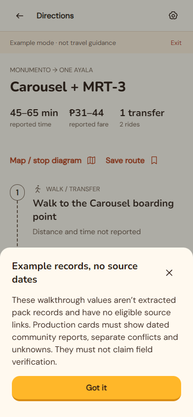

<p align="center">
  
</p>

<h1 align="center">Pusang Gala</h1>

<p align="center">
  <strong>Tara, gala tayo.</strong><br>
  <em>An offline NCR commute companion. Ask Gaile a short Taglish or English question and get route cards built from reviewed community reports,<br>
  then a friendly explanation, without needing mobile data.</em>
</p>

<p align="center">
  <strong>AppBuildersPH 2026 Hackathon</strong><br>
  <em>Local AI on the device, for the commuters who need it offline</em>
</p>

<p align="center">
  
  
  
  
  
  
  
  
</p>

<p align="center">
  
  
  
  
  
</p>

---

## Quick navigation

- [💡 The problem](#-the-problem)
- [✨ What is Pusang Gala?](#-what-is-pusang-gala)
- [🔄 How Pusang Gala works](#-how-pusang-gala-works)
- [🐾 Signature features](#-signature-features)
- [🧩 Architecture](#-architecture)
- [📱 The commuter journey](#-the-commuter-journey)
- [🔒 Built-in guarantees](#-built-in-guarantees)
- [🧰 Tech stack & repo layout](#-tech-stack--repo-layout)
- [🚀 Quick start](#-quick-start)
- [🧪 Testing & evaluation](#-testing--evaluation)
- [🚧 Status & known limitations](#-status--known-limitations)
- [📚 Documentation](#-documentation)
- [📄 License & credits](#-license--credits)

---

## 💡 The problem

> *"Paano pumunta sa…?"*: which jeep to ride, what the signboard says, where to get off and how much to pay.

- **Jeepney knowledge isn't written down officially.** Signboard text, unofficial stops, landmarks like "baba sa may Jollibee", and fares mostly live in people's heads and in forum threads, not in GTFS feeds. Commuters already ask each other on r/HowToGetTherePH, but the answers take hours and get buried.
- **Data can't be assumed on the road.** 97.1% of mobile subscribers are prepaid, and 41.7% of people who don't use the internet name cost as a main barrier. Only 48.8% of households have home internet ([connectivity evidence](docs/reference/pusang-gala-connectivity-evidence.md)). A cloud-only assistant fails at the moment the signal drops.
- **Forum answers can be wrong.** They can be incomplete, contradictory or out of date. A useful tool has to show what the sources support and what is still unknown.

These figures explain why we built it. They are not measured outcomes of the product. Sources are listed in [docs/reference/](docs/reference/).

---

## ✨ What is Pusang Gala?

Pusang Gala is one Android app. After its assets are set up, asking a question, finding a route, the conversation and the cards all work in airplane mode. There is no account, no cloud AI fallback and no upload path.

| Part | Runs on | What it does |
|:---|:---|:---|
| **Gaile** (chat) | Android phone | You ask in Taglish or English, like *"Cubao papuntang Makati?"*. Gaile resolves the places, asks you to choose when a name is ambiguous, and replies in a conversational stream with a Stop button. You can follow up about fares, boarding, transfers, reported hours, cheaper or fewer-transfer options, and the trip home. |
| **Route pack** | Bundled in the APK | A reviewed SQLite pack of NCR places, stops, routes and directed legs, paraphrased from community answers. Every record has a dated, opaque source ID. |
| **Local assistant** | Optional on-device model | Qwen2.5-0.5B-Instruct (GGUF, ~491 MB) running through llama.rn. You download it once or import it over USB, and the app checks its size and SHA-256. Without it, route answers still work. |
| **Corpus tooling** | Developer machine | Audits the raw Reddit dataset, extracts facts, runs a second evidence pass and a review queue, and builds the pack. Raw posts never reach the phone. |

---

## 🔄 How Pusang Gala works

| Stage | What happens | Where |
|:---|:---|:---|
| **01. Curate** | 3,480 NCR posts are audited and the 2,186 with answers are processed. Extraction and a second evidence pass turn them into structured facts and paraphrases. A reviewer resolves ambiguous records. | `tools/corpus/` (off-device) |
| **02. Pack** | Only eligible records go into `pack_ncr-2026-10`: 412 included posts, 494 rejected, 90 pending and left out. The build reports these counts and records checksums. | `tools/pack-builder/` |
| **03. Ask** | The commuter types a question. Core parses the intent and resolves places. If a name is ambiguous, Gaile asks instead of guessing. | `packages/core/`, `apps/mobile/src/conversation/` |
| **04. Route** | Rule-based directed routing joins legs only where the records support boarding, alighting and transfer. Results are ranked into cards, and unknown fares stay unknown. | `packages/core/src/route/`, `src/cards/` |
| **05. Explain** | The cards come first. Gaile then streams a Taglish reply phrased from those cards. Any model output is buffered and checked against the evidence before it is shown. | `apps/mobile/src/routing/`, `src/ai/` |

---

## 🐾 Signature features

### Source-backed routes, never invented

> *"Reports describe past commuter experiences, not verified or live transport data."*

- Every boarding, alighting and transfer comes from a record in the installed pack. If an itinerary is missing a link, it is withheld instead of guessed.
- Cards show reported fares, signboards and post dates. Source dates are labelled as **post dates, not verification dates**.
- Conflicting reports stay visible with their dates. A missing fare is never shown as ₱0.
- *Route reports & sources* opens the full cards and the dated source IDs behind each answer.

### Gaile, a chat that stays on topic

> *"Tara, gala tayo."*

- Gaile handles greetings, questions about who she is and what she can do, route coverage and offline help locally. Replies stream into the chat, and Stop cancels them.
- Follow-ups reuse the current trip: change an endpoint, ask for alternatives or the return trip, or ask about fares, boarding or hours. Each follow-up retrieves fresh evidence.
- Ambiguous places like "Cubao" open a choice sheet. GPS-derived origins also need confirmation.
- When the question is outside NCR, unsupported or incomplete, Gaile says so plainly.

### A local model that's checked before it speaks

> *"Never display unchecked native tokens and try to correct them afterwards."*

- The model is Qwen2.5-0.5B-Instruct Q4_K_M, pinned to an exact ModelScope revision, with a 2,048-token context and up to 384 output tokens. It runs on the CPU with mmap and two threads.
- Output is generated as constrained explanation units that reference canonical statement IDs. Only complete units that pass validation reach the screen. Invalid output falls back to the deterministic summary.
- Route answers don't wait for the model: retrieved facts are phrased locally, so a commute question gets an answer right away.
- A native Android SHA-256 worker (`PusangModelHash`) hashes the GGUF in 1 MB chunks without loading it into JavaScript.

### Offline by default

> *"No account, no cloud, no upload path."*

- The route pack, fonts, licences and artwork ship in the APK. Startup checks the pack's hashes, SQLite integrity and foreign keys before anything loads.
- The model download is the only network call, and you have to start it yourself. After setup, inference works in airplane mode, and the model survives restarts.
- Downloads and generation are cancelled when the app goes to the background. A `.part` file can't reach inference.

### Privacy by design

> *"Questions and location stay on the phone."*

- Raw conversation text and GPS traces are never persisted. The trip store holds only record IDs.
- The release manifest blocks background location, audio and shared-storage permissions, and turns off Android backup and OTA updates. There are no analytics SDKs.
- Raw Reddit wording, usernames and URLs are kept out of the app, the pack and any training data. CI checks this on every push.

---

## 🧩 Architecture



---

## 📱 The commuter journey

These screens come from the UI check (`npm run test:ui`) at 390 px width. Some screens use explicitly labelled example journeys while the map and GPS are still being wired up.

<table align="center">
  <tr>
    <td align="center" width="33%">
      <br>
      <b>Tara, gala tayo.</b><br>
      <em>Meet Gaile, your NCR commute companion.</em>
    </td>
    <td align="center" width="33%">
      <br>
      <b>Where to go?</b><br>
      <em>Ask in chat, or open "Enter landmarks".</em>
    </td>
    <td align="center" width="33%">
      <br>
      <b>Ask Gaile</b><br>
      <em>Streamed Taglish replies over route cards.</em>
    </td>
  </tr>
  <tr>
    <td align="center" width="33%">
      <br>
      <b>Route options</b><br>
      <em>Ranked, with reported fares and unknowns kept.</em>
    </td>
    <td align="center" width="33%">
      <br>
      <b>Directions</b><br>
      <em>Board, ride, transfer and alight, with sources.</em>
    </td>
    <td align="center" width="33%">
      <br>
      <b>Schematic</b><br>
      <em>An ordered sequence for every supported itinerary.</em>
    </td>
  </tr>
  <tr>
    <td align="center" width="33%">
      <br>
      <b>On the way</b><br>
      <em>Manual step progress through the trip.</em>
    </td>
    <td align="center" width="33%">
      <br>
      <b>Nakarating ka!</b><br>
      <em>Trip complete; save it for next time.</em>
    </td>
    <td align="center" width="33%">
      <br>
      <b>Honest sources</b><br>
      <em>Post dates, conflicts and limits, shown plainly.</em>
    </td>
  </tr>
</table>

Each Gaile pose has its own job: compass for readiness, wave for welcome, think for clarification, pointing for answers, map for details, walk for trip progress, cheer for arrival and binoculars for not found ([pose guide](apps/mobile/assets/mascot/README.md)).

---

## 🔒 Built-in guarantees

These "must never" rules come from the [Idea brief §4.2](docs/idea-pusang-gala.md). How each one is enforced is described in [SDD §5.1](docs/sdd-pusang-gala.md).

| # | The product must never… | Where it's enforced |
|:---|:---|:---|
| INV-1 | Invent a route or add a fact that isn't in the installed pack. An incomplete itinerary is withheld. | Directed routing in [`packages/core/src/route/`](packages/core/src/route/); stream guard in [`apps/mobile/src/ai/streaming-guard.ts`](apps/mobile/src/ai/streaming-guard.ts); [`negative-cases.test.ts`](packages/core/test/eval/negative-cases.test.ts) |
| INV-2 | Need a network for asking, routing, conversation, cards or restore after setup, or silently use cloud AI. | Import boundary test in [`packages/core/test/boundary.test.ts`](packages/core/test/boundary.test.ts); release manifest in [`plugins/with-offline-release.cjs`](apps/mobile/plugins/with-offline-release.cjs) |
| INV-3 | Persist raw chat text or GPS traces, or send location, queries or trips anywhere. | ID-only trip store in [`apps/mobile/src/store/`](apps/mobile/src/store/); permissions blocked in the release manifest |
| INV-4 | Ship raw Reddit wording or usernames in the app, the pack or training data. | [`tools/eval/allowlist-check.mjs`](tools/eval/allowlist-check.mjs), run in CI |
| INV-5 | Call a report verified or current, hide its age or conflicts, show a missing fare as zero, or route through suspended services. | Card composer and ranking in [`packages/core/src/cards/`](packages/core/src/cards/), [`src/route/rank.ts`](packages/core/src/route/rank.ts) |
| INV-6 | Silently pick an ambiguous place or a GPS-derived origin. | [`conversation/src/clarification.ts`](apps/mobile/src/conversation/src/clarification.ts); origin confirmation in [`src/location/gps.ts`](apps/mobile/src/location/gps.ts) |
| INV-7 | Train or fine-tune the model on real route facts. | The model is stock Qwen2.5-0.5B-Instruct, and route knowledge lives only in the replaceable pack |

---

## 🧰 Tech stack & repo layout

| Layer | Technology |
|:---|:---|
| App framework | Expo 57.0.27 · React Native 0.86.3 (New Architecture) · React 19.2.3 |
| Language | TypeScript across npm workspaces (Node ≥ 22.13) |
| On-device AI | `llama.rn` 0.12.9, CPU inference, OpenCL off until measured |
| Model | Qwen2.5-0.5B-Instruct GGUF Q4_K_M, 491,400,032 bytes, Apache 2.0 |
| Route data | `expo-sqlite` 57.0.4, read-only pack `pack_ncr-2026-10` (80 routes · 148 directed legs · 65 stops · 91 places · 21 walk links) |
| Map & location | `@maplibre/maplibre-react-native` 11.5.0 · `expo-location` 57.0.20 (foreground only) |
| Files & hashing | `expo-file-system` · `expo-asset` · `expo-crypto` · native `PusangModelHash` worker |
| Design | Sunset Playful palette, Nunito + DM Sans bundled, Gaile artwork in [`apps/mobile/assets/mascot/`](apps/mobile/assets/mascot/) |
| Android build | JDK 17 · SDK platform 36 · Gradle 9.1.0 (pinned by config plugin) · ABIs `arm64-v8a`, `x86_64` |

```
.
├── apps/mobile/                 # Expo app (Android + web preview)
│   ├── App.tsx                  # Entry point
│   ├── src/screens/             # Welcome, Ask, Plan, Journey, Route, Settings screens
│   ├── src/routing/             # Bundled-pack loading, route replies, evidence
│   ├── src/conversation/        # Conversation state, intent, clarification, follow-ups
│   ├── src/ai/                  # Model runtime port, prompt grounding, streaming guard
│   ├── src/inference/           # Qwen install/import, hashing, streamed replies
│   ├── src/store/               # ID-only SQLite trip store and migrations
│   ├── src/ui/                  # Theme, travel components, Gaile
│   ├── native/                  # PusangModelHash Kotlin module
│   ├── plugins/                 # Offline-release, model-hash, Gradle-version config plugins
│   └── assets/                  # Pack, mascot, fonts, licences, Figma SVGs
├── packages/core/               # Pure TS: contracts, normalize, resolve, route, rank, cards
├── tools/
│   ├── corpus/                  # Dataset audit, extraction, evidence pass, review, seed promotion
│   ├── pack-builder/            # SQLite pack, manifest, acceptance checks, mobile bundling
│   ├── eval/                    # Allowlist check, conversation eval, asset/restore checks
│   ├── map-pack/                # Offline NCR basemap packaging (in progress)
│   └── figma-mockups/           # Figma plugin + screen spec
├── data/seed/                   # Reviewed facts and paraphrases only (no raw wording)
├── howtogetthereph_dataset/     # Raw build input; never packaged (INV-4)
└── docs/                        # IDEA, PRD, SDD, CONTRACTS, BUILD, LOG, TODO, UX evidence
```

---

## 🚀 Quick start

### Prerequisites

- **Node.js ≥ 22.13** and npm. The root `package-lock.json` is the only lockfile, so don't install a separate app dependency tree.
- **Android builds:** JDK 17 (`JAVA_HOME`), the Android SDK (`ANDROID_HOME`) with platform 36, build-tools 36.0.0, platform-tools, and the NDK/CMake that the generated Gradle project asks for. No Expo account or EAS cloud build is needed.
- **Local assistant (optional):** `qwen2.5-0.5b-instruct-q4_k_m.gguf`, which the app can download itself. Allow at least 560 MB free on the phone.

### 1. Install and check

```sh
npm ci --no-audit --no-fund
npm run typecheck
npm test
npm run mobile:check
node tools/eval/allowlist-check.mjs
```

### 2. Preview the UI in a browser

```sh
cd apps/mobile
npm run web
```

The web preview shows the full flow. llama.rn and MapLibre can't run in Expo Go or on the web, so the local assistant needs an Android build.

### 3. Build and install on Android

```sh
# From the repository root
npm run android:prebuild               # regenerates the ignored apps/mobile/android
node apps/mobile/scripts/verify-native.cjs
npm run android:release                # or android:development
adb install -r apps/mobile/android/app/build/outputs/apk/release/app-release.apk
```

The release APK includes its JavaScript bundle and doesn't need Metro. Builds print the APK path, size and SHA-256, but only after a successful compile. For a smaller phone-only build, set `ORG_GRADLE_PROJECT_reactNativeArchitectures=arm64-v8a` before building. The local release is signed with the template's debug key, which is fine for install checks but not for distribution.

### 4. Add the local assistant

Open **Settings → Offline resources**, then do one of these:

- **Download local assistant.** It fetches the GGUF from Qwen's [ModelScope repository](https://modelscope.cn/models/Qwen/Qwen2.5-0.5B-Instruct-GGUF) at revision `2e50b77b0eee3083842019e257b74854323d880a`.
- **Import local GGUF.** Copy the file to the phone first (for example, over USB into Downloads). Importing makes no network request and needs no shared-storage permission.

Either way, the file must match `SHA-256 74a4da8c9fdbcd15bd1f6d01d621410d31c6fc00986f5eb687824e7b93d7a9db` and its exact size before it's moved into private storage. After that, Gaile works in airplane mode.

### Rebuild the route pack

```sh
npm run pack:bundle --workspace @pusang-gala/mobile
```

This audits the local raw snapshot against the cleaned seed, writes the SQLite and companion assets, and records checksums in `apps/mobile/src/routing/packCatalog.json`. Raw data is never imported into the app.

### Where data lives

| Data | Location |
|:---|:---|
| Route pack | Bundled: `apps/mobile/assets/pack/pack.sqlite` (+ manifest) |
| Local model | Private app documents: `models/` (`.part` while downloading) |
| Saved trips | Private ID-only SQLite trip store |

---

## 🧪 Testing & evaluation

```sh
npm run typecheck                          # every workspace
npm test                                   # core, mobile, AI, conversation, eval suites
npm run test:ui --workspace @pusang-gala/mobile    # offline screen flows + geometry (Playwright)
node --test tools/eval/allowlist-check.test.mjs    # INV-4 positive/negative fixtures
```

The suites cover normalization, place resolution, graph search and directed routing, ranking, card composition, reported hours, trip restore, pack loading against the real seed, the AI streaming guard and recovery, conversation clarification and follow-ups, the model installer and hashing, and the llama adapter (through injected native contexts). `boundary.test.ts` checks that core imports nothing from React Native, native modules or the network.

**CI.** Two GitHub Actions workflows run on push:

- `member4-checks` runs typecheck, tests, the corpus and pack handoff, Expo config, Android prebuild, an Android bundle export and the INV-4 allowlist.
- `mobile-ui` runs UI asset checks and Playwright screen-flow checks at 320, 390 and 430 px, then uploads the screenshots.

**Conversation eval.** [`tools/eval/conversation`](tools/eval/conversation/) has 65 intent cases (43 held out) and 105 adversarial cases, including unknown values, conflicting reports, injected source instructions, invented-fact bait and reversed-instruction bait. The current report is **preliminary**: it runs against the deterministic stub, and model-backed and on-device scores aren't claimed yet.

**Latest recorded run** ([jeepney-conversation evidence](docs/evidence/jeepney-conversation.md)): full corpus pipeline passed, with pack acceptance at 24/24 checks and the shipped-content scan clean. Corpus and builder 165/165, core seed smoke 15/15 (all fourteen curated journeys), mobile inference, adapter and routing 63/63, AI prompt, stream guard and runtime 89/89. Typechecks and the web chat UI checks passed. No APK was built or installed in that run.

**Corpus reports.** Each pipeline stage writes a report to [`tools/corpus/reports/`](tools/corpus/reports/), covering the audit, evidence, places, eligibility and acceptance stages.

---

## 🚧 Status & known limitations

- **Prototype. No device or release gate is claimed passed.** Compiling the app doesn't count as evidence of phone installation, an offline cold launch or performance.
- **Map, GPS and persistent trips are partly integrated.** MapLibre and `expo-location` are installed, but the offline NCR basemap, live GPS and persistent trip storage are still being wired in. Some screens show explicitly labelled examples.
- **Model performance hasn't been measured on the reference phone** (4 GB RAM, Helio-class). The context and thread defaults are conservative guesses, not measured budgets. GPU inference hasn't been tested.
- **Coverage is limited to what's in the pack.** That's 91 NCR places and 148 directed legs. Both endpoints must be in NCR, and arbitrary addresses map to a nearby supported landmark.
- **Reports aren't live data.** There are no schedules, arrival predictions or live traffic. Old reports stay usable, with their age shown.
- **Not built yet:** accounts, cloud sync, user submissions, voice, iOS, background tracking and arrival alerts.
- **Release signing** still uses the template debug key. A distribution key is planned (T47).

---

## 📚 Documentation

| Document | What's inside |
|:---|:---|
| [docs/index.md](docs/index.md) | Documentation map, feature and invariant traceability |
| [docs/idea-pusang-gala.md](docs/idea-pusang-gala.md) | Scope, release boundary and invariants INV-1 to INV-7 |
| [docs/prd-pusang-gala.md](docs/prd-pusang-gala.md) | Product requirements and acceptance criteria |
| [docs/sdd-pusang-gala.md](docs/sdd-pusang-gala.md) | Architecture, data model and how the invariants are enforced |
| [docs/contracts-pusang-gala.md](docs/contracts-pusang-gala.md) | Shared API and schema contracts |
| [docs/build-pusang-gala.md](docs/build-pusang-gala.md) | Stack, workflow and done criteria |
| [docs/app-walkthrough.md](docs/app-walkthrough.md) | Screen-by-screen app walkthrough |
| [docs/ux-redesign.md](docs/ux-redesign.md) | Playful chat redesign: audit, navigation, validation |
| [docs/TODO.md](docs/TODO.md) | Four-member task plan and PR template |
| [apps/mobile/README.md](apps/mobile/README.md) | Native build, model runtime and adapter details |
| [docs/reference/](docs/reference/) | Original proposal, competitor and connectivity evidence (historical) |

---

## 📄 License & credits

- **Source code:** no license has been chosen yet. Add a `LICENSE` file before publishing this repository for reuse.
- **Route pack:** curated and paraphrased from community answers in r/HowToGetTherePH. It contains no raw posts, comment wording, usernames or Reddit URLs. See [`PACK-NOTICE.txt`](apps/mobile/assets/licences/PACK-NOTICE.txt).
- **Model:** Qwen2.5-0.5B-Instruct by the Qwen team, under Apache 2.0 ([`MODEL-LICENCE.txt`](apps/mobile/assets/licences/MODEL-LICENCE.txt)).
- **Inference:** [llama.cpp](https://github.com/ggml-org/llama.cpp) through [`llama.rn`](https://github.com/mybigday/llama.rn).
- **Fonts:** Nunito and DM Sans, both under the SIL Open Font License 1.1 (licences in [`apps/mobile/assets/licences/`](apps/mobile/assets/licences/)).
- **Artwork:** Gaile, the Pusang Gala cat, was made for this project.

<p align="center">
  <br>
  <sub>Built by The Avenir for NCR commuters · <b>Tara, gala tayo.</b></sub>
</p>
