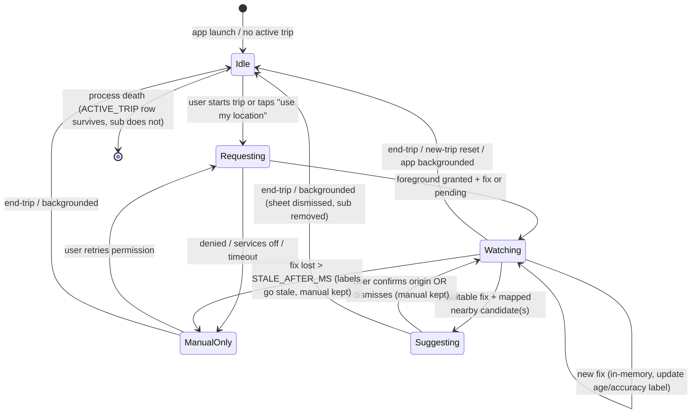

# Spike T43+T44 — Foreground GPS lifecycle + saved/active-trip persistence

**Owner:** Member-4 · **Branch:** `dev/member-4-mobile-maps-gps`
**Tasks:** T43 (foreground GPS + confirmed origin) · T44 (saved/history/active-trip)
**Design basis:** `docs/sdd-pusang-gala.md` §1.6 (Map/GPS/assets), §3.3 (user entities), §3.4 (validation/replacement), §5.1 INV-3/INV-6 · **Gates:** S3, S7 (S4 joint with Member-3)
**Status:** Spike (design-only, no code). Passing this spike does not complete T43/T44.

## 1. Question this spike answers

Can we implement, on the T40 Expo dev-build + T42 MapLibre map:

1. Exactly one foreground `expo-location` subscription during an active trip, with accuracy/fix-age labels, denied/no-fix fallback to manual input, and guaranteed cleanup on background/end-trip (INV-3)?
2. A mapped-nearby-origin suggestion that **never auto-selects** and requires explicit user confirmation (INV-6)?
3. A `user.sqlite` persistence layer storing only stable record IDs + manual step (never raw chat, transcripts, GPS coords/traces, Firebase UIDs, or cloud sync), with pack-compatible revalidation and replanning on restore?

## 2. Decisions / constraints (from SDD, non-negotiable)

- **Single foreground subscription.** One `Location.watchPositionAsync` per active-trip session. No background-location plugin, no geofencing, no automatic trip detection, no recorded trace (SDD §1.6, TODO T43).
- **Fixes are in-memory only.** `timestamp`, `coords.{latitude,longitude,accuracy}`, fix-age derived at render. Never written to `user.sqlite`, logs, diagnostics, or analytics (INV-3).
- **Mapped-only suggestions.** A GPS fix may only suggest an origin that (a) has coordinate evidence + `mapping_status=mapped`, (b) has accepted NCR membership, (c) has a `ready` PLACE_STOP access path. Proximity never creates access (SDD §3.4). Unmapped places stay in cards/schematic as unmapped.
- **Mandatory confirmation (INV-6).** GPS suggestion → explicit confirm/dismiss sheet. Dismiss keeps manual origin. Ambiguous nearby candidates → clarification list, never auto-pick.
- **Manual input always works.** Denied permission, disabled services, or no fix → full manual origin/destination flow, no blocking modal, no degraded-cards state.
- **Persistence stores IDs only.** `route_json` holds ordered `leg_id`/`stop_id`/`place_id` arrays + preference + manual step. No query text, no chat transcript, no lat/lng columns, no trace table (SDD §3.3).
- **Restore revalidates against the installed pack.** `trip.restore(pack)` returns `ValidTrip | NeedsReplan` with a reason. Pack replacement never silently keeps obsolete instructions (SDD §3.4, T25 contract owned by Member-2).

## 3. GPS lifecycle design (T43)

### 3.1 Lifecycle diagram



Backed by exactly one owner module (proposed `apps/mobile/src/location/` — Member-4, T43):

- `location.start()` → requests foreground permission **only when useful** (trip active or user tapped locate), creates the single subscription, returns a handle.
- `location.stop()` → removes the subscription, clears in-memory fix, cancels pending suggestion sheet. Idempotent.
- Guard: `start()` while already watching returns the existing handle (no second subscription). Log a local counter only (no coords).

### 3.2 Subscription shape (Expo Location, foreground only)

```ts
// Proposed contract (settled with T00/T20 result types; no background APIs).
type Fix = { lat: number; lng: number; accuracyM: number | null; atMs: number };
type WatchHandle = { stop(): void };

async function start(): Promise<WatchHandle | Denied | ServicesOff> {
  // 1. hasServicesEnabledAsync() → ServicesOff preserves manual input.
  // 2. requestForegroundPermissionsAsync() → Denied preserves manual input.
  // 3. getLastKnownPositionAsync() for instant (possibly stale) fix, then:
  // 4. watchPositionAsync({ accuracy: Accuracy.Balanced, timeInterval: 2000,
  //      distanceInterval: 5 }, onFix) — exactly once per session.
}
```

- **No `startLocationUpdatesAsync` / TaskManager background tasks.** Dependency allowlist must reject `expo-background-fetch`, `expo-task-manager` location tasks, and any telemetry/crash-upload SDK (INV-3 negative check).
- Tune `accuracy`/`timeInterval`/`distanceInterval` on the reference phone in S3; `Balanced` is the starting point for battery vs. fix quality, not a final claim.
- Pause on `AppState` → `background/inactive`: call `stop()`. Resume in foreground does **not** auto-restart; user re-taps locate or continues manually (prevents background trace + stale-fix surprise).

### 3.3 Accuracy / fix-age labels (INV-5 + S3 evidence)

Every rendered fix shows both values; a fix without a fresh timestamp is labelled, never silently used:

| Label | Rule (initial thresholds, to confirm on reference phone) |
|---|---|
| `accuracy` | `≤10 m` good · `10–50 m` approximate · `>50 m` or null → coarse/unreliable |
| `fix age` | `age = nowMs - fix.atMs`; `<10 s` fresh · `10–30 s` aging · `>30 s` **stale — do not suggest** |
| `no fix` | No fix within `NO_FIX_TIMEOUT_MS` (proposed 15 s) → "Waiting for GPS… keep manual input" persistent state |

- Stale fixes never trigger suggestions and are visually marked stale on the map marker.
- Diagnostics record counters/timings only (fixes obtained, stale count, denied count) — no coordinates (SDD §5).

### 3.4 Mapped-nearby-origin suggestion (INV-6)

Trigger **all** must hold, else stay silent on manual input:

1. Fix is fresh (`age ≤ 30 s`) and accuracy is good/approximate (`≤50 m` or tighter after S3 measurement).
2. At least one `PLACE` within `SUGGEST_RADIUS_M` (proposed 150 m, confirm on device) satisfies: `ncr_status=accepted` + `mapping_status=mapped` + exists a `ready` PLACE_STOP access row.
3. No suggestion is currently displayed (one sheet at a time).

Behaviour:

- Show bottom sheet: "Near [Place display name]? Use as origin?" + accuracy/age line + **Use / Keep manual / disambiguation list** if >1 candidate.
- **Confirming** sets `origin_place_id` in current-trip state and re-runs `core.resolve → core.route` (Member-2 contracts). **Dismissing** keeps the manual origin untouched.
- Negative checks (INV-6): ambiguous GPS neighbourhood auto-picks nothing; GPS never overwrites a user-typed origin; unmapped/ambiguous/outside-NCR places never appear as suggestions even if closest.
- Suggestion candidates resolve through `core.resolve` place resolution so alias/ambiguity rules stay in one owner (Member-2); location module only supplies the candidate shortlist + fix quality.

### 3.5 Denied / no-fix / error handling

| Case | UX | State |
|---|---|---|
| Permission denied (incl. "only this time" expiry) | Inline notice: "Location off — enter origin manually." + [Try again] + [Open settings] deep-link | `ManualOnly`; trip/cards unaffected |
| Location services disabled | Same manual fallback + system-settings prompt | `ManualOnly` |
| Timeout / no fix (indoor, airplane-mode GPS cold start) | "Waiting for GPS…" with elapsed timer; manual input stays primary; stale label if last fix ages out | `ManualOnly` or stale `Watching` |
| Fix error / subscription throws | Toast + retry; subscription torn down and recreated at most once per user action (no hot loop) | `ManualOnly` |
| Background / end-trip / new-trip reset | Silent `stop()` + dismiss sheet; no prompt | `Idle` |

Airplane-mode note: GPS receiver works without network but cold-start fixes are slow indoors. S3 evidence must include an **outdoor** run; indoor "no fix → manual works" is itself a passing sub-case.

### 3.6 Cleanup contract (INV-3)

- `end-trip`, `new-trip reset`, `AppState background`, unmount of trip screen, and process death all converge to: **zero live subscriptions**.
- Enforcement: single-handle invariant (`activeHandle: WatchHandle | null`), `stop()` idempotent, effect-cleanup in the trip screen (`useEffect return stop`), AppState listener registered once.
- Negative test: background the app during `Watching`/`Suggesting`, assert via location-module counter/mock that `remove()` was called and no new fixes dispatch; relaunch shows manual state + persisted ACTIVE_TRIP (no fix restored).

## 4. Persistence design (T44)

### 4.1 Tables (SDD §3.3 — proposed DDL, settled in T00)

`user.sqlite` holds **only** the tables below. There is deliberately **no** `CHAT_LOG`, `FIX_LOG`, `TRACE`, `*_lat`, `*_lng`, or sync/UID column.

```sql
-- Forward-only numbered migrations (SDD §3.4). Sketch only; T00 versions it.
CREATE TABLE IF NOT EXISTS USER_SETTING(
  key TEXT PRIMARY KEY, value TEXT NOT NULL
);
CREATE TABLE IF NOT EXISTS ACTIVE_TRIP(
  trip_id INTEGER PRIMARY KEY CHECK (trip_id = 1),  -- exactly one row
  pack_id TEXT NOT NULL, schema_version INTEGER NOT NULL,
  origin_place_id TEXT NOT NULL, destination_place_id TEXT NOT NULL,
  preference TEXT NOT NULL,
  route_json TEXT NOT NULL,   -- ordered record IDs only, e.g. {"leg_ids":[...],"stop_ids":[...]}
  current_step INTEGER NOT NULL DEFAULT 0,
  started_at TEXT NOT NULL
);
CREATE TABLE IF NOT EXISTS SAVED_ROUTE(
  saved_id TEXT PRIMARY KEY,
  pack_id TEXT NOT NULL,
  origin_place_id TEXT NOT NULL, destination_place_id TEXT NOT NULL,
  preference TEXT NOT NULL, route_json TEXT NOT NULL,
  label TEXT,                  -- user-authored name only, never a pasted query
  created_at TEXT NOT NULL
);
CREATE TABLE IF NOT EXISTS TRIP_HISTORY(
  history_id TEXT PRIMARY KEY,
  pack_id TEXT NOT NULL,
  origin_place_id TEXT NOT NULL, destination_place_id TEXT NOT NULL,
  preference TEXT NOT NULL, route_json TEXT NOT NULL,
  kind TEXT NOT NULL CHECK (kind IN ('looked_up','taken')),
  at TEXT NOT NULL
);
CREATE TABLE IF NOT EXISTS INSTALLED_ASSET(
  asset_id TEXT PRIMARY KEY, kind TEXT NOT NULL, file_path TEXT NOT NULL,
  version TEXT NOT NULL, sha256 TEXT NOT NULL, bytes INTEGER NOT NULL,
  state TEXT NOT NULL, license TEXT
);
```

`route_json` example (IDs only): `{"leg_ids":["leg Cuenca→Cubao …"],"place_ids":[…],"note_ids":[…]}` — exact field list settled with Member-2 in T00/T25; no free text.

### 4.2 Write / delete rules

- **ACTIVE_TRIP:** upsert on trip select / `advanceStep()` / preference change. Delete on end-trip (after optionally appending `TRIP_HISTORY kind='taken'`), on new-trip reset, and when restore yields NeedsReplan and user accepts replan.
- **SAVED_ROUTE:** explicit Save action only, with user label prompt (default "Route N"). Explicit delete control per row (PRD F15). No auto-save of every lookup.
- **TRIP_HISTORY:** append `looked_up` on completed routing, `taken` on end-trip with `current_step` at end. Explicit per-row delete + Clear-all. No timestamps fabricated — `at` is device-local ISO time.
- **Survives process death; never survives uninstall.** All writes in a single SQLite transaction; `current_step` update is atomic with route IDs.

### 4.3 Restore + pack-compat revalidation → replanning

On cold start (and after pack replacement), `trip.restore(pack)` (Member-2 helper, T25; Member-4 calls it from the loader path T41):

```text
load ACTIVE_TRIP row (if none → no trip to restore)
  → check schema_version known? pack_id matches installed pack?
  → parse route_json; every place/leg/stop/note ID exists in new pack?
  → every leg still eligibility=ready, service not suspended/retired?
  → connection order continuous (alight(n) joins board(n+1) via ready WALK_LINK/PLACE_STOP)?
  → current_step within [0, len(steps)-1]?
  → all pass → ValidTrip (reconstruct cards via core.compose, map markers for mapped only)
  → else → NeedsReplan { reason: unknown_schema | pack_changed | record_missing
        | record_retired | connection_broken | step_out_of_bounds }
        → keep manual endpoints, rerun core.route, tell user what changed.
```

Same checks apply when opening a SAVED_ROUTE or TRIP_HISTORY entry (missing/retired records → offer replan, never render obsolete boarding instructions). Unknown `schema_version` always forces NeedsReplan, never a migration guess.

### 4.4 Schema checklist (PR/loader gate — copy into T44 PR)

- [ ] `user.sqlite` contains only the five SDD §3.3 tables; schema dump shows no `lat/lng/trace/chat/transcript/uid/sync` column or table.
- [ ] `route_json` samples contain ID arrays + preference + step only (spot-check 3 rows; no query text or coordinates).
- [ ] ACTIVE_TRIP holds ≤1 row; process-kill + relaunch restores step/cards (S7 sub-case).
- [ ] Pack-swap test: retire/rename one leg in a fixture pack → restore returns NeedsReplan with the right reason; replan produces new IDs; old instructions never render.
- [ ] `schema_version` bump test → NeedsReplan (`unknown_schema`), no crash.
- [ ] Saved/history delete + clear-all work; labels are user-typed (empty default allowed), never auto-filled from query.
- [ ] Grep gate: `rg -i "lat|lng|latitude|longitude|trace|chat_log|transcript|firebase|telemetry" apps/mobile/src/location apps/mobile/src/store` shows no persistence call-site (in-memory fix type only).
- [ ] Dependency gate: no `expo-task-manager` background location, no analytics/crash SDK in manifest/lockfile.

## 5. S3 / S7 evidence plan (what to run on the reference phone)

S3 — "Does foreground GPS work offline with the map mounted?" (Member-4):

1. **Cold airplane-mode launch** (T42 map mounted): enable GPS-only device location, go outdoors, start trip → first fix ≤60 s (record actual), marker renders with accuracy circle + fresh age label.
2. **Accuracy/age labels:** screenshot fresh (`<10 s`), aging, and stale (`>30 s`, simulated by holding indoor) states; diagnostics counters attached, no coords logged.
3. **Suggestion + confirmation:** stand near a mapped fixture stop → sheet appears → Confirm sets origin and routes; Dismiss keeps manual origin. Second run with two nearby mapped stops → disambiguation list, no auto-pick.
4. **Denied/no-fix:** deny permission → manual flow completes a route; disable services → same; indoor cold-start timeout → "Waiting for GPS" + manual success.
5. **Cleanup:** background mid-watch → assert unsubscribed (counter/log); end-trip → assert unsubscribed + sheet dismissed; force-stop + relaunch → ACTIVE_TRIP restored, no fix restored, zero subscriptions until user action.
6. Record: device model/ABI/Android/RAM, Expo/RN/`expo-location` versions, thresholds used, timings, screenshots, log excerpts (scrubbed of coords).

S7 — persistence/integration slice (feeds T45):

1. **Process death:** active trip at step 2 → kill → relaunch offline → same step/cards/markers restored.
2. **Pack change:** swap in fixture pack with one retired leg → restore yields NeedsReplan → replan routes; history entry on old pack offers replan, never old steps.
3. **Save/history:** save 2 routes with custom labels → relaunch → open, delete one, clear history; dump schema proving IDs-only.
4. **20-query lifecycle soak** (joint S4/S7 with Member-3): 20 mixed queries with map+GPS mounted and AI streaming; record peak PSS, no-subscription-leak, restore-after-background, unsupported-device fallback if applicable.

Fail bar: any auto-selected origin, any background fix dispatch, any raw-chat/coords column, any obsolete-instruction render, or any network fetch during these runs fails the spike's follow-up implementation PR.

## 6. Open items for T00 / follow-up PRs

- Exact `route_json` field list + `WatchHandle`/result-union types with Member-2 (T00/T25); explanation-unit contract untouched (Member-3).
- Final thresholds (`SUGGEST_RADIUS_M`, staleness bounds, intervals) from reference-phone measurement, not this doc.
- `expo-location` + MapLibre version pinning happens in T40; this spike assumes foreground-only API availability.
- Follow-up implementation PRs (T43, T44) must attach S3/S7 evidence above; this spike file is the plan, not the proof.

*Built on SPINE 0.3.0 — spike plan for T43+T44; implementation + device evidence follow in task PRs.*
