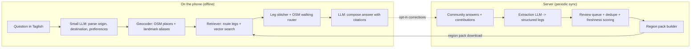

# Pusang Gala: Local-AI Commute Directions for the Philippines

**Project proposal · Draft v0.1 · October 2026**

| | |
|---|---|
| Working name | Pusang Gala |
| Team | appBuilders |
| Platforms | Android first, then iOS |
| Status | Seeking approval for a 6-week prototype |

A phone app that answers "Paano pumunta sa…?" the way a helpful local would: which jeep to ride, what the signboard says, where to get off and how much to pay. It runs on the device and works on weak or no mobile data.

---

## 1. Summary

Filipino commuters already solve this problem by asking each other. [r/HowToGetTherePH](https://gummysearch.com/r/HowToGetTherePH/) has about 297,000 members posting and answering route questions, many of them outside Metro Manila. Pusang Gala turns that kind of local, informal-transit knowledge into a structured route database. A small language model on the phone then answers questions in Taglish from that database. Unlike existing apps, it covers jeepneys, UV Express, tricycles and provincial buses outside NCR, and it keeps working when the signal drops.

**Example answer** (illustrative; fares and routes are not verified)

> *"Pano pumunta sa SM Masinag galing Cubao? First time ko po."*
>
> 1. **Jeep:** Ride a jeep with signboard **CUBAO – ANTIPOLO** along Aurora Blvd. Get off at SM Masinag, Marcos Hwy. *≈ ₱20–30*
> 2. **Walk:** The mall entrance faces the highway. About 2 minutes.
>
> *Sources: 3 community answers · last confirmed Aug 2026 · confidence: high*

---

## 2. Problem

Informal transit is mostly missing from route apps.

- **The knowledge is tacit.** Signboard text, unofficial stops, "baba sa may Jollibee" landmarks and current fares live in people's heads and in forum threads, not in GTFS feeds.
- **Coverage stops at NCR.** Sakay.ph is strong in Metro Manila but does not cover other cities. Google Maps is weak on jeepneys and tricycles.
- **Asking takes hours.** A Reddit question can take hours to get a good answer, and the answer gets buried. The same corridors are asked about again and again.
- **Data is unreliable on the road.** Commuters hit dead zones, ration prepaid data, or run phones low on battery. Cloud-only AI fails exactly when they need it.

| Existing option | Strength | Gap Pusang Gala fills |
|---|---|---|
| [Sakay.ph](https://apps.apple.com/ph/app/sakay-ph-commute-directions/id937998546) | Jeep, bus and train routing with fares in NCR | Regions outside Metro Manila; conversational questions |
| [Sansa Sakay](https://www.sansasakay.com/) | Crowd-reported live route status | Route planning from A to B |
| Google Maps | Rail, major buses, walking | Jeepneys, tricycles, signboards, local landmarks |
| r/HowToGetTherePH | Rich local answers | Instant answers, search, offline use, freshness tracking |
| [ph-commute.com](http://www.ph-commute.com/), guide sites | Written step-by-step guides | Any-origin queries; updates |

---

## 3. Solution

| Feature | Description |
|---|---|
| Ask in plain Taglish | Type or speak a question. The model works out origin, destination and preferences such as cheapest, fewest transfers or avoiding EDSA. |
| Step-by-step legs | Each leg shows the vehicle type, signboard, where to board and alight, a fare range, and a walking map from OSM data. |
| Shows its sources | Each step links to the community answers behind it, with a "last confirmed" date and a confidence level. |
| Works offline | Region packs bundle map tiles, the route database and the model. Download Region IV-A once and use it without data. |
| Contribute routes | Commuters confirm, correct or add legs after a trip. This replaces scraping over time. |
| Private by design | Questions and location stay on the phone. Sharing contributions is opt-in and anonymised. |

---

## 4. Architecture

The language model never invents geography. Retrieval supplies the routes and the map engine supplies distances. The model's job is to understand the question and write the answer from the retrieved legs.

| Layer | Choice | Why |
|---|---|---|
| On-device LLM | Qwen or Gemma, 1.5–4B parameters, 4-bit quantized, on llama.cpp | Fits mid-range Android phones (about 6 GB RAM); handles Taglish reasonably well |
| Embeddings | Small multilingual embedding model | Matches "Masinag" and "SM Masinag Antipolo" style variants |
| Route store | SQLite + vector index (sqlite-vec) | One file per region, so it's easy to ship and update |
| Maps and walking | OpenStreetMap tiles + GraphHopper or Valhalla (offline) | Open data with proven offline routing |
| App | Kotlin (Android) first; Flutter if iOS is needed soon | Best native access to the device's GPU and NPU for inference |
| Server pipeline | Python, a larger LLM for extraction, Postgres | Extraction runs in batches, so it doesn't need to be on the phone |

---

## 5. Data Strategy

Each route leg is stored as a structured record:

| Field | Example |
|---|---|
| `mode` | jeepney · uv_express · bus · tricycle · rail · ferry · walk |
| `signboard` | "Cubao – Antipolo" |
| `board_at` / `alight_at` | Landmark text + coordinates, e.g. "Aurora Blvd cor. 15th Ave" |
| `fare_min` / `fare_max` | ₱ range, with the year it was reported |
| `region` | NCR · Region III · Region IV-A · … |
| `sources` / `last_confirmed` | Source IDs, date, number of confirmations |
| `notes` | "Rush hour: line at terminal 30+ min" |

> **⚠ Reddit content needs a licensing decision before anything ships.** Reddit's terms restrict scraping and commercial or AI use of its content. For the prototype, we use only a small set of hand-collected examples for internal testing. Before launch, we pick one of three paths:
> - **(a)** a data agreement with Reddit
> - **(b)** asking moderators and contributors for permission, and linking out instead of copying
> - **(c)** building our own dataset from scratch through contributions and partners

- **Seed sources we can use:** OpenStreetMap public-transport relations, LTFRB published route and fare data where available, and partner LGUs or schools.
- **Contributions:** after each trip, ask "Did this route work?" with one tap. Corrections go to a review queue.
- **Freshness:** confidence drops as data ages and rises with confirmations. Fares older than 12 months are flagged in the app.

---

## 6. MVP Scope

**In scope**
- One corridor: Metro Manila ↔ Rizal (Cubao, Antipolo, Marikina, Cainta)
- About 300 hand-checked route legs
- Offline question answering on one mid-range Android phone
- Answers with sources, fare ranges and a confidence level
- Confirm or correct a route

**Not in this phase**
- Live traffic or vehicle tracking
- iOS app
- Bulk ingestion from Reddit
- Voice input
- Turn-by-turn navigation while walking

---

## 7. Roadmap

| When | Phase | Work |
|---|---|---|
| Weeks 1–2 | Data and extraction | Define the leg schema. Hand-collect the Rizal corridor. Test LLM extraction against hand-labelled answers until it reaches at least 85% field accuracy. |
| Weeks 3–4 | Desktop prototype | Build the retrieval, leg-stitching and answer pipeline on a laptop with Ollama. Write 100 test questions and score the answers. |
| Weeks 5–6 | Android prototype | Port to llama.cpp on Android with an offline region pack. Measure speed, RAM and battery use. Test with 10–15 commuters. |
| Months 2–4 | Pilot | Settle the data licensing path. Add contributions and the review queue. Expand to Region III and IV-A. Closed beta with about 500 users. |
| Months 5+ | Public launch | Add Visayas and Mindanao city packs (Cebu, Davao), an iOS app and voice input. Explore partnerships with LGUs and campuses. |

---

## 8. Risks and Mitigations

| Risk | Level | Mitigation |
|---|---|---|
| Data licensing: Reddit terms block use of its content | **High** | Don't depend on it. Plan for contributions and open data from the start, and treat Reddit as a partnership option rather than the foundation. |
| A wrong route strands someone | **High** | Answer only from retrieved legs. Show sources and confidence. Say "not enough data yet" instead of guessing. |
| Routes and fares go out of date (jeepney modernization, fare changes) | Medium | Confidence that drops with age, one-tap confirmations, and ingesting LTFRB fare announcements. |
| Small models struggle on low-end phones | Medium | A 1.5B fallback model, template answers when no LLM is available, and an optional cloud mode. |
| Thin coverage at launch (cold start) | Medium | Launch corridor by corridor. Recruit campus and office commuter groups as early contributors. |
| Region packs are large to download | Medium | Split packs by province, offer Wi-Fi-only downloads, and share the model file across regions. |

---

## 9. Success Metrics (Prototype, Week 6)

| Metric | Target |
|---|---|
| Answers rated correct and usable by local reviewers | ≥ 80% of 100 test questions |
| Answers that contain an invented leg | ≤ 2% |
| Time to first answer, offline, mid-range phone | ≤ 8 s |
| Region pack size (Rizal corridor), including model | ≤ 1.5 GB |
| Testers who would use it instead of posting to Reddit | ≥ 7 of 10 |

---

## 10. Resources Needed

- **People:** 1 ML / backend developer, 1 Android developer, and 1 part-time data curator who commutes the corridor.
- **Hardware:** a laptop with a GPU (8 GB VRAM or more) for extraction and testing, plus two Android test phones (one low-end, one mid-range).
- **Software:** all open source (llama.cpp, Ollama, SQLite, GraphHopper, OSM data). Cloud costs are limited to an optional extraction server; use the provider's pricing calculator for estimates.
- **Time:** 6 weeks to a go/no-go decision for the pilot.

---

## 11. Open Questions

1. Which data path to pursue first: a Reddit agreement, moderator collaboration, or our own community?
2. Is the Rizal corridor the right first test, or should we start with a region Sakay.ph doesn't cover, such as Cebu?
3. Should there be an optional cloud mode for older phones, and how do we keep it private?
4. Business model: free with sponsored LGU or campus packs, a premium region bundle, or non-profit?

---

## References

- [r/HowToGetTherePH subreddit stats](https://gummysearch.com/r/HowToGetTherePH/)
- [Sakay.ph – Commute Directions App](https://apps.apple.com/ph/app/sakay-ph-commute-directions/id937998546)
- [Sansa Sakay – Jeepney & UV Express Tracker](https://www.sansasakay.com/)
- [Commuting in the Philippines 101](http://www.ph-commute.com/)
- [Organic Maps](https://organicmaps.app/)
- [Offline navigation pipeline with a local LLM, OSRM and OpenStreetMap](https://guttikondaparthasai.medium.com/how-i-built-an-offline-navigation-pipeline-using-a-local-llm-osrm-and-openstreetmap-120ec64b5af0)

*Fares, targets and timelines are planning estimates and haven't been validated in the field.*
