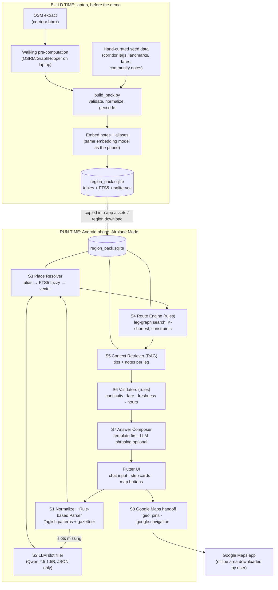
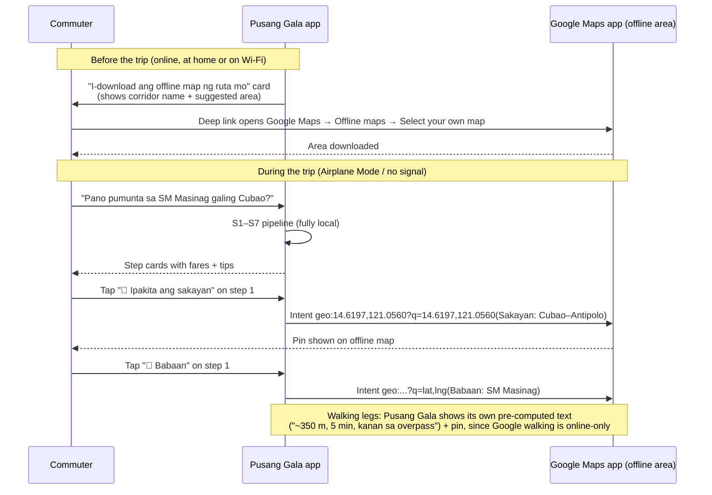
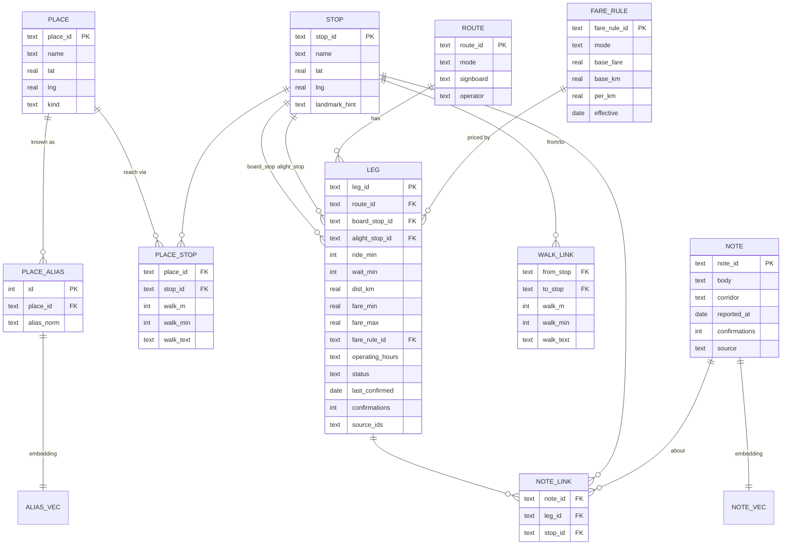

# Pusang Gala: System Architecture

**Hybrid RAG + rule-based pipeline with a Google Maps Offline handoff · AppBuilders 2026 Hackathon build · v0.1**

Inputs: `Pusang Gala Hackathon Proposal Validation.pdf`, `pusang-gala-proposal.md`, `pusang-gala-competitor-analysis.md`, `pusang-gala-connectivity-evidence.md`.

---

## 1. Design Principles

The validation report sets the constraints. Every design choice below traces back to one of them.

| # | Principle | Reason (from the validation report) |
|---|---|---|
| P1 | **Rules decide the route; the LLM only phrases it.** | A small model can't be trusted to invent multi-leg directions. Every leg in an answer must exist in the database. |
| P2 | **The pipeline still works if the LLM fails or is too slow.** | Demo risk. If the model runs out of memory or is slow, template answers still produce a correct route. |
| P3 | **All heavy work happens on the laptop before the demo.** | Embeddings, walking distances and the leg graph are pre-computed. Nothing parses OSM `.pbf` or builds graphs on the phone. |
| P4 | **No GraphHopper or Valhalla on the device.** | It causes out-of-memory crashes on Android and is no longer maintained for mobile. Walking legs are pre-computed, and **Google Maps Offline** shows the map. |
| P5 | **CPU-only inference, small context window.** | GPU offloading (OpenCL or Vulkan) on Adreno chips is slower than the CPU. Use Qwen 2.5 1.5B at Q4, a 2,048-token context and a capped output length. |
| P6 | **Everything works in Airplane Mode.** | The judging rubric weights Local AI at 25%, and the demo is done offline on stage. |

---

## 2. High-Level Architecture



Two sources of truth:
- **Structured tables** (legs, stops, fares) feed the **rule engine**. These decide *what route* is given.
- **Unstructured text** (community notes, tips, landmark descriptions) feeds **RAG**. This decides *what advice accompanies* each step.

The LLM sits beside both and is never the source of a fact.

---

## 3. Runtime Pipeline, Stage by Stage

### S1: Normalize + Rule-based Parser (always runs, <5 ms)

Turns the Taglish question into slots: `origin`, `destination`, `preference`, `time`.

**Normalization**
- Lowercase, strip emoji, collapse spaces.
- Expand shorthand with a lookup table: `pano→paano`, `pnta→punta`, `sa may→sa`, `cor.→corner`, `brgy→barangay`.

**Pattern rules** (ordered; the first match wins)

| Rule | Pattern (simplified) | Example |
|---|---|---|
| R-P1 | `(paano\|how) .* (pumunta\|pupunta\|makarating) sa {DEST} (galing\|mula\|from) {ORIG}` | "Paano pumunta sa SM Masinag galing Cubao" |
| R-P2 | `(galing\|mula) {ORIG} (papunta\|to\|hanggang) {DEST}` | "Galing PITX papuntang Tagaytay" |
| R-P3 | `{ORIG} (to\|->\|-) {DEST}` | "Cubao to Antipolo" |
| R-P4 | `(pauwi\|uuwi) (ng\|sa) {DEST}`, with origin = last known or ask | "Pauwi ng Lipa" |
| R-PF | Preference keywords: `pinakamura\|cheapest` → `cost`; `pinakamabilis\|fastest` → `time`; `konting sakay\|less transfer` → `transfers`; `iwas edsa` → avoid tag | |
| R-PT | Time keywords: `rush hour\|ngayon\|mamayang gabi\|5am` → time bucket | |

**Output:** `{origin_text, dest_text, pref, time_bucket, confidence}`. If either place slot is empty, go to S2. Otherwise skip the LLM entirely.

### S2: LLM Slot Filler (only when S1 fails)

- Qwen 2.5 1.5B Instruct, Q4, through `flutter_gemma` (LiteRT-LM) or `llama.cpp` with CPU threads only.
- The prompt asks for **JSON only**: `{"origin": str|null, "destination": str|null, "preference": "cost|time|transfers|null"}`.
- Limits: context `-c 1024`, output `-n 64`, temperature 0.
- The output is parsed and schema-checked. If it's invalid twice, the UI asks a follow-up question ("Saan ka manggagaling?").

### S3: Place Resolver (gazetteer → fuzzy → vector)

This turns "Masinag mall", "SM Masinag Antipolo" or "sa may Masinag" into `place_id = P_SM_MASINAG`.

| Step | Method | Accept if |
|---|---|---|
| 1 | Exact match on `place_alias.alias_norm` | hit |
| 2 | SQLite FTS5 `MATCH` with trigram tokenizer + edit-distance score | score ≥ 0.85 |
| 3 | sqlite-vec KNN on `alias_vec` (embedding of the query span) | cosine ≥ 0.80 **and** margin to 2nd result ≥ 0.05 |
| 4 | Otherwise | Show the top 3 as tap-to-choose chips (never guess) |

The margin rule keeps "SM Megamall" from being chosen for "SM Masinag".

### S4: Route Engine (rule-based, the core)

The **leg graph** is pre-built at build time:
- **Nodes** = `stop` (a board or alight point: terminal, corner, landmark).
- **Edges** = `leg` (a jeep, UV, bus, tricycle or train ride) plus `walk_link` (pre-computed walking between nearby stops, ≤ 600 m).
- The origin and destination places connect to their nearest stops through `place_stop` links, which store pre-computed walk times.

**Search:** Yen's K-shortest paths (K = 3) using Dijkstra over the graph. A corridor pack has fewer than 5k edges, so this runs in milliseconds on a phone.

**Cost function** (weights depend on `pref`):

```
cost = w_time * (ride_min + wait_min + walk_min)
     + w_fare * fare_php
     + w_xfer * transfers * 8          # each transfer ≈ 8 min penalty
     + w_walk * max(0, walk_m - 400)/100
     + freshness_penalty(leg)          # stale legs cost more
```

| pref | w_time | w_fare | w_xfer |
|---|---|---|---|
| default | 1.0 | 0.5 | 1.0 |
| cost | 0.4 | 2.0 | 0.6 |
| time | 2.0 | 0.2 | 0.8 |
| transfers | 0.8 | 0.4 | 3.0 |

**Hard constraints** (rules R-C*). A path that breaks any of these is dropped:
- R-C1: at most 3 rides (as Lugar.ph does) and at most 1.2 km of walking in total.
- R-C2: each leg's `operating_hours` must cover the time bucket (for example, a P2P bus with no 9 PM trip).
- R-C3: legs with `status = discontinued` are skipped.
- R-C4: no leg reverses back into the same corridor (prevents loops and "go back to Cubao").
- R-C5: user "avoid" tags (for example `avoid:edsa`).

### S5: Context Retriever (the RAG layer)

For each leg in the chosen path, fetch the supporting knowledge:

1. **Structured lookup:** notes linked to that `leg_id`, `board_stop_id` and `alight_stop_id` through `note_link`.
2. **Semantic lookup:** sqlite-vec KNN over `note_vec`, **filtered to the path's corridor**, with the query `"{signboard} {board} {alight} {time_bucket}"`, top-k = 4.
3. **Re-rank:** `score = 0.6*similarity + 0.25*freshness + 0.15*confirmations_norm`, then keep the top 2 per leg.

The result is short tips with source IDs, for example *"Sabihin sa driver: 'Para sa Masinag.' Malapit sa overpass ang babaan."* `[N-0142, confirmed Aug 2026]`.

The RAG layer **never adds or removes legs**. It only attaches tips to them.

### S6: Validators (rule-based safety net)

| Rule | Check | On failure |
|---|---|---|
| R-V1 Continuity | `leg[i].alight_stop` connects to `leg[i+1].board_stop` (same stop or a walk_link) | Drop the path |
| R-V2 Fare sanity | `fare_min ≤ computed ≤ fare_max`; jeep fare computed from the fare table (base + per-km) | Show a range plus a "fare may have changed" flag |
| R-V3 Freshness | `last_confirmed` older than 12 months → confidence downgraded | Show a ⚠ "Hindi pa nakukumpirma kamakailan" badge |
| R-V4 Coverage | No path found | Return an honest "Wala pa kaming datos para dito" with the nearest covered stop |
| R-V5 Citation | Every step carries ≥ 1 `source_id` | A step with no source can't be shown |
| R-V6 LLM output guard | Every place name, signboard and number in the LLM text appears in the step facts | Fall back to the template text |

### S7: Answer Composer

**Template first.** The answer is deterministic, fast and always correct:

```
{n}. [{MODE}] Sumakay ng {mode_tl} na may signboard na "{signboard}" sa {board_stop}.
   Bumaba sa {alight_stop}. ≈ ₱{fare_min}–{fare_max} · ~{ride_min} min
   💡 {tip_1}
```

**Optional LLM phrasing** (a toggle in settings, on by default if the device has ≥ 6 GB RAM):
- Input: the validated step JSON plus tips. That's around 400 tokens. Output limit `-n 220`, streamed token by token to hide latency.
- System prompt: *"Rewrite these steps in friendly Taglish. Do not add places, vehicles, fares, or numbers. Keep step order."*
- **R-V6** then checks the output. If it fails, the template text is shown and nobody sees the failure.

### S8: Google Maps Offline Handoff

See §4.

---

## 4. Google Maps Offline Integration

### 4.1 What Google Maps Offline can and cannot do

| Capability | Offline? | Source |
|---|---|---|
| View a map and pins inside a downloaded area | ✅ | [Google Maps Help](https://support.google.com/maps/answer/6291838?hl=en) |
| Search places inside a downloaded area | ✅ (basic) | [Google Maps Help](https://support.google.com/maps/answer/6291838?hl=en) |
| **Driving** turn-by-turn directions (whole route inside the area) | ✅ (no traffic) | [Google Maps Help](https://support.google.com/maps/answer/6291838?hl=en) |
| **Walking, transit, cycling** directions | ❌ **Not available offline** | [Google Maps Help](https://support.google.com/maps/answer/6291838?hl=en) |
| Embedding Google tiles in *our* app for offline use (Maps SDK) | ❌ **Not allowed**: the terms forbid pre-fetching or caching content | [Map Tiles API Policies](https://developers.google.com/maps/documentation/tile/policies) |
| Offline maps expire and must be refreshed | ⚠ Auto-updates over Wi-Fi when ≤ 15 days remain | [Google Maps Help](https://support.google.com/maps/answer/6291838?hl=en) |

**What this means for the design:** Pusang Gala uses **the user's own Google Maps app with a downloaded offline area** as its map viewer. We hand it pins and driving routes through Android intents. We **don't** embed or cache Google tiles ourselves, and we **don't** rely on Google for walking or jeepney routing. Pusang Gala's pre-computed data handles those parts.

### 4.2 Integration flow



### 4.3 Intent catalogue

All intents use `Intent.ACTION_VIEW`, `setPackage("com.google.android.apps.maps")` and a `resolveActivity()` guard. URI formats are from the [Android Google Maps Intents guide](https://developer.android.com/guide/components/google-maps-intents).

| Button on step card | Intent URI | Works offline? |
|---|---|---|
| 📍 Sakayan (boarding point) | `geo:0,0?q={lat},{lng}({label})` | ✅ inside the downloaded area |
| 📍 Babaan (alight point) | `geo:0,0?q={lat},{lng}({label})` | ✅ |
| 🚗 Taxi / Grab / private car leg (optional) | `google.navigation:q={lat},{lng}&mode=d` | ✅ driving only |
| 🛺 Tricycle leg (show road path) | `google.navigation:q={lat},{lng}&mode=d` | ✅ (a driving route approximates the tricycle path) |
| 🚶 Walking leg | Pusang Gala text + `geo:` pin for the endpoint | ✅ (Google walking directions are online-only) |
| 🗺 Whole trip overview | Sequential pins (one per stop); no multi-stop transit view offline | ✅ |

```dart
// Flutter (android_intent_plus): open a labeled pin in Google Maps
Future<void> openPin(double lat, double lng, String label) async {
  final uri = 'geo:0,0?q=$lat,$lng(${Uri.encodeComponent(label)})';
  final intent = AndroidIntent(
    action: 'action_view',
    data: uri,
    package: 'com.google.android.apps.maps',
  );
  if (await intent.canResolveActivity() ?? false) {
    await intent.launch();
  } else {
    showFallbackSketch(lat, lng, label); // see 4.4
  }
}
```

### 4.4 Fallbacks

| Situation | Behaviour |
|---|---|
| Google Maps not installed or the intent can't be resolved | Show an in-app **route sketch**: a simple canvas drawing of stops and legs from the pack's coordinates, with no map tiles. |
| Offline area not downloaded (Google Maps shows a blank or gray map) | The pre-trip card shows a **"Not downloaded yet"** reminder. Step cards always include the text landmark, so the route still works without a map. |
| Stretch goal after the hackathon | Bundle OSM vector tiles (PMTiles) with MapLibre for an in-app map that doesn't depend on Google. |

---

## 5. Region Pack Data Model

One SQLite file per corridor or region (`region_pack.sqlite`), built on the laptop and shipped in the app's assets.



- `NOTE_VEC` and `ALIAS_VEC` are `vec0` virtual tables (sqlite-vec), stored as `float[dim]` or `int8[dim]`. They're keyed by rowid and carry metadata columns (`corridor`, `freshness`) so filtering doesn't need joins.
- `FTS5` virtual table over `place_alias.alias_norm` with `tokenize='trigram'`, for fuzzy place matching.
- **`walk_text` is pre-computed on the laptop** from OSM (for example, "Lumabas sa Gate 3, kumanan, 350 m"). This follows the validation report's advice to pre-compute walking instead of running GraphHopper on the phone.
- `FARE_RULE` values come from the current LTFRB fare matrix and are entered by hand at build time. **Don't hard-code fares in app logic.**

---

## 6. Build-Time Pipeline (laptop)

```
seed/                        # hand-curated, versioned in git
  places.csv  aliases.csv  stops.csv  routes.csv  legs.csv  notes.csv  fare_rules.csv
tools/
  build_pack.py              # one command → region_pack.sqlite
```

`build_pack.py` steps:
1. **Validate the CSVs.** Required fields present, coordinates inside the corridor's bounding box, every leg's stops exist, fares in range, and every leg has a source ID.
2. **Normalize aliases.** Apply the same normalization code as S1. Share one rules file (`rules/normalize.yaml`) between Python and Dart so they can't drift.
3. **Compute walking.** Run OSRM or GraphHopper *on the laptop* (foot profile) over the corridor's OSM extract. For every stop pair ≤ 600 m apart, and every place → nearest 3 stops, store meters, minutes and a short text.
4. **Embed** notes and aliases with **the same embedding model and quantization the phone uses**. A different model would put the vectors in a different space.
5. **Write SQLite.** Tables, FTS5, vec0, and `PRAGMA user_version = pack_version`.
6. **Self-test.** Run the 30 golden questions (§9) through a Python port of S1, S3, S4 and S6, and fail the build on any regression.

Data source policy (from the proposal): for the hackathon, use **only a small hand-curated seed set** for a non-commercial demo. Don't bulk-scrape Reddit. After the event, data comes from in-app contributions plus open data (OSM public-transport relations, LTFRB route plans).

---

## 7. Technology Stack

| Layer | Choice | Notes |
|---|---|---|
| App | **Flutter** (Android target) | `flutter_gemma` gives LiteRT-LM inference plus embeddings, as the validation report recommends |
| LLM | **Qwen 2.5 1.5B Instruct**, 4-bit | Best Taglish handling and JSON adherence in the report's comparison. Swap to 3B only if the demo phone has ≥ 8 GB RAM. |
| Inference runtime | `flutter_gemma` / LiteRT-LM (primary); `llama.cpp` CPU-only (fallback) | No OpenCL or Vulkan offload on Adreno |
| Embeddings | Small on-device embedding model supported by `flutter_gemma` (target ≤ ~150 MB) | Confirm the exact model and version supported in the package before kickoff |
| Database | `sqlite3` + **sqlite-vec** (`vec0`) + FTS5 | One file per region |
| Rule engine | Plain Dart: Dijkstra/Yen over an in-memory adjacency list | The graph for a corridor is under 1 MB |
| Rules config | `rules/*.yaml` (normalization, patterns, weights, thresholds), bundled as an asset | Change rules without changing code; shared with the Python build |
| Maps | **Google Maps app (offline area)** through `android_intent_plus` | `geo:` pins and `google.navigation:` driving routes |
| Build tools | Python 3.11, OSRM or GraphHopper (laptop only), the same embedding model | |

---

## 8. Memory and Latency Budget (target: 6 GB RAM mid-range Android)

| Component | RAM | Latency target |
|---|---|---|
| Flutter app + UI | ~150 MB | — |
| Region pack (SQLite, memory-mapped) | 20–60 MB | — |
| Embedding model | ~100–150 MB | ~50–150 ms per query |
| Qwen 2.5 1.5B Q4 weights | ~1.0–1.2 GB | load once at startup, ~3–6 s |
| KV cache at 2,048 context | ~100–200 MB | — |
| **Total peak** | **~1.6–1.8 GB** | Leaves headroom against Android's OOM killer |
| S1 → S6 (rules + retrieval) | — | **< 300 ms** |
| S7 template answer | — | **< 50 ms**, shown immediately |
| S7 LLM rephrase (optional) | — | First token < 1.5 s, streamed at ~8–15 tok/s |

**Demo trick:** show the template answer immediately, then stream the friendlier LLM version on top of it. The judge sees a result in under a second, and the AI contribution is still visible.

---

## 9. Worked Example (trace)

**Query:** *"Pano pumunta sa SM Masinag galing Cubao? Pinakamura sana."*

| Stage | Result |
|---|---|
| S1 | Pattern R-P1 matched → `origin="cubao"`, `dest="sm masinag"`, R-PF → `pref=cost`. **LLM skipped.** |
| S3 | `cubao` → alias exact → `P_CUBAO`; `sm masinag` → alias exact → `P_SM_MASINAG` |
| S4 | 3 candidate paths. Cheapest: `walk(P_CUBAO→S_AURORA_15TH)` → `LEG_JEEP_CUBAO_ANTIPOLO(S_AURORA_15TH→S_MASINAG)` → `walk(S_MASINAG→P_SM_MASINAG)` |
| S5 | Tips: N-0142 "Sabihin 'Para sa Masinag'…"; N-0217 "Rush hour, mahaba pila sa Aurora…" |
| S6 | Continuity ✅, fare within range ✅, last confirmed recently ✅, all steps have sources ✅ |
| S7 | Template rendered at ~40 ms; LLM Taglish version streams in afterwards and passes R-V6 |
| S8 | Step 1 shows buttons for 📍 Sakayan / 📍 Babaan, which open `geo:` pins in offline Google Maps |

*(Stops, fares and note IDs in this example are placeholders until the seed data is entered.)*

---

## 10. Testing

| Test | What | When |
|---|---|---|
| **Golden set** (30 questions) | Taglish variants per corridor, with expected `origin`, `destination` and first leg | Every build (`build_pack.py`) and in a Dart unit test |
| Parser unit tests | Each R-P / R-PF rule, positive and negative cases | `flutter test` |
| Route engine tests | Constraints R-C1 to R-C5; K-shortest ordering under each preference | `flutter test` |
| Guard test | Feed S7 a deliberately wrong LLM output; check that R-V6 falls back to the template | `flutter test` |
| Airplane-mode smoke test | On the demo phone: 5 golden questions plus map pins, with radios off | Before code freeze |
| Memory soak | 20 back-to-back queries; watch `adb shell dumpsys meminfo` for growth | Before code freeze |

---

## 11. Hackathon Build Order (Oct 9–10, code freeze 10:00 AM)

The order puts the risky parts behind a working core. After each block, the demo still works.

| Block | Deliverable | If it slips |
|---|---|---|
| 1 | Seed CSVs for one corridor (~40–80 legs, ~60 aliases, ~40 notes) + `build_pack.py` → SQLite with FTS5 | — (required) |
| 2 | Flutter shell: chat input → S1 parser → S3 alias/FTS → S4 Dijkstra → S7 **template** answer | — (this is the minimum demo) |
| 3 | S8 Google Maps `geo:` buttons + pre-trip "download offline area" card | Show text landmarks only |
| 4 | S6 validators + golden tests | Keep R-V1 and R-V5 only |
| 5 | sqlite-vec + embeddings → S3 vector fallback + S5 tips | Use tips linked to legs only (no vector search) |
| 6 | Qwen 2.5 1.5B → S2 slot fallback + S7 streamed rephrasing with R-V6 guard | Template-only answers. The rule pipeline is still fully local, but the "Local AI" score drops, so try hard to land this block. |
| 7 | Airplane-mode rehearsal, memory soak, record a backup demo video | — |

**Disclosure for submission:** Qwen 2.5 1.5B (model), flutter_gemma/LiteRT-LM or llama.cpp (runtime), sqlite-vec (vector search), OSRM/GraphHopper (laptop-only pre-computation), the Google Maps app (map display through intents), and the AI coding tools used.

---

## 12. Known Limitations

- **Walking directions in Google Maps don't work offline.** Pusang Gala's pre-computed walking text covers it, but it's only as good as the seed data.
- **Google Maps offline areas need to be downloaded ahead of time and expire.** Users must download them while online, so the pre-trip card is essential.
- **Embedding Google tiles in Pusang Gala isn't allowed**, so there is no in-app Google map. Use a sketch fallback now and MapLibre with OSM tiles later.
- **Coverage = seed data.** Questions outside the corridor get an honest "no data yet", never a guess.
- **Fare values must come from the current LTFRB fare matrix.** All numbers in this document are placeholders.
