# System Design: Pusang Gala

**PRD:** [prd-pusang-gala.md](prd-pusang-gala.md)

This is a design-first document. No code exists yet. It is `Draft`: nothing may be built from it until the owner locks it, except the de-risking spikes in §9, which the owner may authorize separately.

---

## 1. Architecture

Pusang Gala is an Android app built with React Native and an Expo development build.

- The **core** (asking, resolving, routing, cards, persona, map, GPS, saved routes) runs fully on-device. It never touches the network.
- From 1.1, an **optional account module** uses Firebase (Auth plus Firestore) for sign-in, sync and community submissions. It is the only code allowed to use the network, and only after sign-in plus opt-in. The core does not import it.

Corridor packs are built off-device by a TypeScript CLI. The CLI shares its normalization and validation code with the app, so the app and the builder can never disagree about how text is normalized.

Design principle: the database owns the facts, rules decide the route, and the model only interprets the question and adds persona flavour. Persona text never carries a fact (INV-1), and the model is never trained on facts (INV-7).

```text
 BUILD TIME (team laptop, online)                    RUN TIME (phone, airplane mode)
 ───────────────────────────────                     ──────────────────────────────────────────
 Reddit scrape (outside repo, raw) ─┐                 Question ─► normalize ─► rule parser
 Field surveys / team notes ────────┤ human           │                          │ slots missing
 LTFRB fare matrix ─────────────────┤ curation        │                          ▼
 OSM (Geofabrik PH extract) ────────┤ ──► data/seed/  │                    SLM slot extractor (llama.rn, GBNF)
 Approved submissions (1.1) ────────┘      *.csv      │                          │ schema + span check
            (facts only, no Reddit text)              ▼                          ▼
                tools/pack-builder (TS) ──► pack.sqlite ─► place resolver (alias / FTS5 trigram / typo)
                 validate · normalize ·    + manifest        │ ambiguous ─► ALWAYS ask (INV-6)
                 INV-4 scan · checksum                       ▼
 Protomaps planet ─► pmtiles extract ──► mm.pmtiles         router (multi-criteria label search)
 (MM+Rizal bbox, z≤15) + style/glyphs/sprites               ▼
 GGUF model (pinned rev + sha256) ────────────► model.gguf  validators (continuity, fare, hours, provenance, staleness)
                                                             ▼
                                                deterministic step cards ◄── persona composer + guard
                                                             │
                                  ┌──────────────────────────┼───────────────────────────┐
                                  ▼                          ▼                           ▼
                        schematic view (1.0)     MapLibre map + GPS (1.1)     user.sqlite: saved / history /
                                                                              confirmations / submissions
                                                                                         │ only if signed in + opted in
                                                                                         ▼
                                                                    account module (1.1) ──► Firebase Auth + Firestore
                                                                                         ──► review queue ──► curator ──► data/seed
```

Deployment target: Android 7+ (the Expo SDK 57 minimum). The goal is to reach as many phones as possible. The reference phone has 4 GB RAM, 64 GB storage and a budget MediaTek Helio-class chip (owner, 2026-10-09).

### 1.0 Device tiers

The app decides its tier at first launch, using `expo-device` (total RAM, supported ABIs) plus a 1-query benchmark. The user can override the tier in settings.

| Tier | Detected when | Gets |
|------|---------------|------|
| Full | arm64-v8a, ≥ 3.5 GB RAM, benchmark extraction ≤ 5 s | Rules, SLM extraction, SLM persona line, all other features |
| Lite | arm64-v8a, about 2.5–3.5 GB RAM, or a benchmark of 5–10 s | Rules, plus the SLM only as a fallback after the rules fail; template persona only; all other features |
| Core | 32-bit Android, < 2.5 GB RAM, or the model fails to load | Rules only, pickers, template persona, all other features. **No core feature lost** |

Device facts that shape these tiers:
- llama.rn supports only arm64-v8a and x86_64.
- Budget Helio chips such as G85 and G99 are Cortex-A75/A76 + A55 parts. They have the ARMv8.2 dot-product instructions that llama.cpp's Q4_0 fast path uses, but no NPU or GPU path that llama.rn supports. Inference is therefore CPU-only, with 4 threads on the big cores.
- Q4_0 is preferred over Q4_K_M. llama.cpp repacks Q4_0 for arm64, so it runs faster.
- Firebase features (1.1) need Google Play services. Without them, the account module stays hidden.

### 1.1 Asset delivery

| Asset | Measured or known size | Hackathon / sideload build | Play Store build |
|-------|-----------------------|----------------------------|------------------|
| App code + JS bundle | tens of MB (to be measured) | In the APK | Base module (Play limit 500 MB) |
| Route pack `pack.sqlite` | < 5 MB expected at 40–80 legs; grows with corridors | In the APK (`expo-asset` embed) | Base module |
| Map `mm.pmtiles` + style, glyphs, sprites (1.1) | **55 MB** at z≤15 for Metro Manila + Rizal, bbox `120.90,14.35,121.35,14.80`. Measured with `pmtiles extract --dry-run` on Protomaps build 20261009 | In the APK | Base module |
| Model GGUF | 219–446 MB at Q4_0, depending on the S5 winner (measured on Hugging Face) | In the APK | **Fast-follow asset pack**, hosted free by Google Play (1.5 GB per-pack limit) |

All core assets ship with the app, and **no team-run download server exists**.

- On first launch, the app copies embedded files to `filesDir` and verifies their SHA-256. llama.cpp and the `pmtiles://file://` source both need real file paths.
- Play fast-follow packs land as plain files at an absolute path: Play Core `AssetPackManager.getPackLocation().assetsPath()`. llama.rn loads the model from that path directly. Until the pack arrives, the app runs in the Core tier.
- The `expo-play-asset-delivery` plugin only returns files as base64, which is unusable for a model this size. The Play build therefore needs a small custom Expo module that wraps `AssetPackManager` (spike S6).
- Pack and map updates ship as app updates.

### 1.2 Account module (1.1)

| Aspect | Design |
|--------|--------|
| Sign-in | Google sign-in through `@react-native-google-signin/google-signin`, then Firebase Auth via `@react-native-firebase/auth`. No password accounts. |
| Storage | Cloud Firestore through `@react-native-firebase/firestore`, with collections `users/{uid}/saved`, `users/{uid}/history`, `confirmations` and `submissions`. Firestore offline persistence queues writes made offline. |
| Opt-in | Sync is off until the user turns it on (USER_SETTING `sync_enabled`). Signing in alone uploads nothing. |
| What is uploaded | Saved and history items (route record IDs, place IDs, pack ID, timestamps), confirmations (route ID, yes/no, date) and submissions (structured fields plus the user's own note). Raw query text and GPS coordinates are never uploaded (INV-3). |
| Security rules | Users read and write only `users/{uid}/**`. `confirmations` and `submissions` are create-only for the author, and only the team can read them. Nothing is publicly readable. |
| Deletion | An in-app "Delete account" action deletes `users/{uid}/**` and the user's submissions and confirmations, then the Auth user. A static web page (Firebase Hosting) explains how to request deletion through the in-app action or by email (Google Play policy). |
| Moderation | Submissions land in `submissions` with `status=pending`. A curator reviews them; accepted facts are re-entered into `data/seed/` with a SOURCE row of kind `consented_contribution`, then ship in the next pack. The approval method is `TBD(owner)` Q14. |
| Aggregates | "N commuters confirmed" is computed at pack build time from `confirmations` and stored on the leg. The app never queries counts live. |
| Cost | The Firebase Spark free tier covers Auth, plus Firestore at 50k reads, 20k writes and 1 GiB storage per day. It is enough for the pilot. Check Firebase pricing before scaling. |
| Privacy | A Data Privacy Act privacy notice is shown before sync is enabled. The Play Data Safety form declares the account data. |

## 2. Components

All paths are proposed (design-first). None of them exists yet.

| Component | Responsibility | Serves | Location |
|-----------|---------------|--------|----------|
| Normalizer | Lowercase, strip diacritics and punctuation, and expand Taglish shorthands (e.g. "pano"→"paano") using a shared rules file | PRD-F1, PRD-F2, PRD-F10 | `packages/core/src/normalize/` |
| Rule parser | Pattern rules for "galing X papunta Y", "from X to Y", "pa-Y", plus preference words (mura/mabilis/konting lipat) | PRD-F1 | `packages/core/src/parse/` |
| SLM slot extractor | Runs llama.rn with a JSON schema converted to GBNF, the model's non-thinking chat template, an output cap of about 96 tokens and 4 threads, with a timeout and native cancel. Returns `origin_text`, `destination_text`, `preference` and `time_text` (nullable). It is model-agnostic: the model file and chat template come from a manifest | PRD-F1 | `apps/mobile/src/ai/extract.ts` |
| Device tier detector | Classifies the phone as Full, Lite or Core (§1.0) and sets which AI features run | PRD-F1, PRD-F5, PRD-F8 | `apps/mobile/src/ai/tier.ts` |
| Span validator | Rejects model output whose spans don't appear in the normalized query, and rejects swapped or invented endpoints | PRD-F1, INV-1 | `packages/core/src/parse/validateSlots.ts` |
| Place resolver | Tries an exact alias match, then FTS5 trigram candidates, then Damerau-Levenshtein ranking. Aliases shorter than 3 characters go through an exact table. Any alias listed in PLACE_AMBIGUITY, or a low margin between candidates, always returns `needs_clarification` | PRD-F2, INV-6 | `packages/core/src/resolve/` |
| Clarification UI | Shows 2–4 candidates, each with its area or landmark, in the cat voice ("Aling SM? Masinag o Cubao?") | PRD-F2, PRD-F5, INV-6 | `apps/mobile/src/ui/Clarify.tsx` |
| Router | Multi-criteria label-setting search over directed legs and walk links. Labels carry cost, ride count, walk metres, time and current route ID, and only non-dominated labels are kept. Cycles are prevented explicitly. The fare is charged once per boarding | PRD-F3 | `packages/core/src/route/` |
| Route validators | Check continuity, operating hours at the estimated boarding time, fare-rule application, record existence and provenance. Any failure drops the route | PRD-F3, PRD-F4, INV-1 | `packages/core/src/validate/` |
| Staleness labeller | Compares `last_verified` and `FARE_RULE.effective` against `PACK_MANIFEST.stale_after_days`, and GPS fix age against a threshold. Marks a card or marker stale | PRD-F4, PRD-F7, INV-5 | `packages/core/src/validate/staleness.ts` |
| Card composer | Builds deterministic step cards only from pack records. Each card carries its record IDs and its stale flags | PRD-F4, PRD-F9 | `packages/core/src/compose/` |
| Persona composer | The cat voice. Picks intro, outro and tip-lead lines from a curated template bank. Optionally, the SLM writes one short line from a placeholder-only schema (`{dest}`, `{mode}`), and the composer fills the placeholders from the cards | PRD-F5 | `packages/core/src/persona/` |
| Persona guard | Rejects any SLM persona line containing a digit, ₱, or any pack vocabulary token (place, alias, stop, signboard, mode), and replaces it with a template line | PRD-F5, INV-1 | `packages/core/src/persona/guard.ts` |
| Pack store | Opens the read-only `pack.sqlite` through expo-sqlite and checks the manifest checksum and schema version | PRD-F2, PRD-F3, PRD-F8 | `apps/mobile/src/data/pack.ts` |
| User store | A separate `user.sqlite` holding settings, active trip, saved routes, history, confirmations, the submission outbox and installed-asset state | PRD-F7, PRD-F8, PRD-F15, PRD-F17, PRD-F18 | `apps/mobile/src/data/user.ts` |
| Saved and history manager | Saves and lists routes and history, and re-validates saved routes against the current pack on load | PRD-F15, INV-1, INV-5 | `apps/mobile/src/data/saved.ts` |
| Asset installer | On first run, copies embedded assets to `filesDir` or locates the Play fast-follow pack, verifies SHA-256, and reports readiness. It makes no network calls of its own | PRD-F8, INV-2 | `apps/mobile/src/setup/` |
| Schematic view | Draws the stop-sequence diagram with RN views or SVG | PRD-F12 | `apps/mobile/src/map/Schematic.tsx` |
| Map view (1.1) | MapLibre RN v11 with a local style JSON, a `pmtiles://file://…` source, local glyphs and sprites, and layers for stops and route geometry. Shows the attribution control | PRD-F6 | `apps/mobile/src/map/` |
| Location service (1.1) | A single expo-location foreground `watchPositionAsync` subscription. Tracks accuracy and fix age, and pauses when the app is backgrounded | PRD-F7, INV-5 | `apps/mobile/src/location/` |
| Network guard | Wraps fetch, XHR and WebSocket. Outside `apps/mobile/src/account/`, any call throws in dev and is blocked and logged locally in release. Lint plus CI forbid the core from importing Firebase | INV-2, INV-3 | `apps/mobile/src/net/guard.ts` |
| Account module (1.1) | Sign-in, the sync opt-in, Firestore sync of the PRD-F15 data, the confirmation and submission outbox, and account deletion (§1.2) | PRD-F16, PRD-F17, PRD-F18 | `apps/mobile/src/account/` |
| Firestore rules and deletion page (1.1) | Security rules, plus the static account-deletion web page | PRD-F16 | `firebase/firestore.rules`, `firebase/hosting/` |
| Pack builder | CLI that turns `data/seed/*.csv` into `pack.sqlite` plus a manifest. Validates schema and geography; rejects Reddit text, usernames and unapproved submissions; folds in confirmation aggregates; writes the FTS index and checksum | PRD-F10, PRD-F17, INV-1, INV-4 | `tools/pack-builder/` |
| Map pack script | Runs `pmtiles extract` on the Metro Manila + Rizal bbox and bundles the style, glyphs and sprites | PRD-F6, PRD-F10 | `tools/map-pack/` |
| Eval harness | Labelled query set, route fixtures and a persona-guard corpus. Runs rules-only and hybrid modes, on Node (llama.cpp) and on device | PRD-F1, PRD-F3, PRD-F5 | `tools/eval/` |
| Fine-tune data generator | Builds synthetic Taglish queries from **placeholder place names** (no real stops, signboards or fares), slot labels and persona lines. CI checks the output contains no real pack vocabulary | PRD-F1, PRD-F5, INV-4, INV-7 | `tools/finetune/` |
| Tip store | Paraphrased tips linked to legs and stops, with a mention count | PRD-F11 | pack `note` tables; `packages/core/src/compose/tips.ts` |

## 3. Data model

**Schema file:** none yet (design-first)

The ERD below is the schema contract (hard rule 16): code may only use the entities, fields and relationships it defines.

There are two on-device databases:
- `pack.sqlite` is read-only and is replaced wholesale when a pack updates.
- `user.sqlite` is writable and survives pack replacement. Entities from `USER_SETTING` onward live here.

The Firestore collections in §1.2 mirror the `SAVED_ROUTE`, `TRIP_HISTORY`, `ROUTE_CONFIRMATION` and `SUBMISSION` fields, with the addition of `uid`.

### 3.1 Entity-relationship diagram

```mermaid
erDiagram
    PLACE ||--o{ PLACE_ALIAS : "known as"
    PLACE ||--o{ PLACE_STOP : "reached via"
    STOP ||--o{ PLACE_STOP : "serves"
    PLACE ||--o{ PLACE_AMBIGUITY : "candidate for"
    ROUTE ||--o{ LEG : "has"
    STOP ||--o{ LEG : "boarded at"
    STOP ||--o{ LEG : "alighted at"
    FARE_RULE ||--o{ ROUTE : "prices"
    STOP ||--o{ WALK_LINK : "walk from"
    STOP ||--o{ WALK_LINK : "walk to"
    LEG ||--o| SHAPE : "drawn as"
    WALK_LINK ||--o| SHAPE : "drawn as"
    NOTE ||--o{ NOTE_LINK : "about"
    LEG ||--o{ NOTE_LINK : "tipped"
    STOP ||--o{ NOTE_LINK : "tipped"
    SOURCE ||--o{ RECORD_SOURCE : "evidences"
    PACK_MANIFEST ||--o{ CORRIDOR : "covers"
    PLACE {
        text place_id PK
        text name
        real lat
        real lng
        text kind "landmark|mall|school|terminal|area"
        text area "city or barangay, shown in clarification"
    }
    PLACE_ALIAS {
        integer alias_id PK
        text place_id FK
        text alias_norm UK "normalized via shared rules"
        text alias_display
    }
    PLACE_AMBIGUITY {
        integer ambiguity_id PK
        text alias_norm "ambiguous text, e.g. sm"
        text place_id FK
    }
    STOP {
        text stop_id PK
        text name
        real lat
        real lng
        text landmark_hint
    }
    PLACE_STOP {
        text place_id FK
        text stop_id FK
        integer walk_m
        integer walk_min
        text walk_text
    }
    ROUTE {
        text route_id PK
        text mode "jeepney|modern_jeepney|uv_express|bus|tricycle|rail|walk"
        text signboard
        text fare_rule_id FK
        text operating_hours "nullable; HH:MM-HH:MM local"
        integer headway_min "nullable; typical wait estimate"
    }
    LEG {
        text leg_id PK
        text route_id FK
        text board_stop_id FK
        text alight_stop_id FK
        integer ride_min
        real dist_km
        real fare_min "nullable; override when rule does not apply"
        real fare_max "nullable"
        text status "verified|unverified|retired"
        text last_verified "ISO date"
        integer confirmations "aggregate at build time; default 0"
    }
    WALK_LINK {
        text walk_id PK
        text from_stop_id FK
        text to_stop_id FK
        integer walk_m
        integer walk_min
        text walk_text
        text status "verified|unverified|retired"
        text last_verified "ISO date"
    }
    SHAPE {
        text shape_id PK
        text leg_id FK "nullable; exactly one of leg_id/walk_id"
        text walk_id FK "nullable"
        text geojson "LineString"
        integer schematic "0 verified geometry, 1 straight-line"
    }
    FARE_RULE {
        text fare_rule_id PK
        text mode
        real base_fare
        real base_km
        real per_km
        text effective "ISO date"
        text source_note
    }
    NOTE {
        text note_id PK
        text body "team-authored paraphrase only"
        integer mentions
        text reported_at "ISO date"
    }
    NOTE_LINK {
        integer note_link_id PK
        text note_id FK
        text leg_id FK "nullable; exactly one of leg_id/stop_id"
        text stop_id FK "nullable"
    }
    SOURCE {
        text source_id PK
        text kind "field_survey|reddit_thread|ltfrb|osm|team|consented_contribution"
        text url "nullable; link only, never content"
        text observed_at "ISO date"
        text license "nullable"
    }
    RECORD_SOURCE {
        integer record_source_id PK
        text record_kind "leg|walk_link|stop|place|fare_rule|note"
        text record_id
        text source_id FK
    }
    PACK_MANIFEST {
        text pack_id PK
        integer schema_version
        text bbox "minLng,minLat,maxLng,maxLat"
        integer stale_after_days "default 180"
        text created
        text verified
        text sha256
    }
    CORRIDOR {
        text corridor_id PK
        text pack_id FK
        text name
        text bbox "verified-coverage bounds"
        text verified "ISO date"
    }
    USER_SETTING {
        text key PK
        text value
    }
    ACTIVE_TRIP {
        integer trip_id PK
        text pack_id
        text origin_place_id
        text destination_place_id
        text route_json "selected route record IDs"
        integer current_step
        text started_at
    }
    SAVED_ROUTE {
        text saved_id PK "uuid"
        text pack_id
        text origin_place_id
        text destination_place_id
        text route_json "record IDs; re-validated on load"
        text label "nullable"
        text created_at
        text synced_at "nullable"
    }
    TRIP_HISTORY {
        text history_id PK "uuid"
        text pack_id
        text origin_place_id
        text destination_place_id
        text route_json "record IDs only; never coordinates"
        text kind "looked_up|taken"
        text at
        text synced_at "nullable"
    }
    ROUTE_CONFIRMATION {
        text confirmation_id PK "uuid"
        text pack_id
        text leg_id "pack record ID"
        integer worked "1 yes, 0 no"
        text at
        text synced_at "nullable"
    }
    SUBMISSION {
        text submission_id PK "uuid"
        text kind "fare|stop|signboard|new_route|other"
        text target_record_id "nullable; pack record ID"
        text payload_json "structured fields"
        text note "user-written; nullable"
        text status "draft|queued|sent|accepted|rejected"
        text created_at
        text synced_at "nullable"
    }
    INSTALLED_ASSET {
        text asset_id PK
        text kind "model|pack|map"
        text file_path
        text version
        text sha256
        integer bytes
        text state "missing|verifying|ready|failed"
        text license
    }
```



### 3.2 Entity register

| Entity | Serves | Constrained by | Data class | Retention | Notes |
|--------|--------|----------------|------------|-----------|-------|
| PLACE | PRD-F2 | INV-1 | public | Pack lifetime | `area` disambiguates choices |
| PLACE_ALIAS | PRD-F1, PRD-F2 | — | public | Pack lifetime | FTS5 trigram index over `alias_norm` |
| PLACE_AMBIGUITY | PRD-F2 | INV-6 | public | Pack lifetime | An alias found here always triggers clarification |
| STOP | PRD-F3, PRD-F4 | INV-1 | public | Pack lifetime | |
| PLACE_STOP | PRD-F2, PRD-F3 | INV-1 | public | Pack lifetime | First and last walk from a place |
| ROUTE | PRD-F3, PRD-F4 | INV-1 | public | Pack lifetime | One row per signboard and direction |
| LEG | PRD-F3, PRD-F4, PRD-F17 | INV-1, INV-5 | public | Pack lifetime | Directed |
| WALK_LINK | PRD-F3, PRD-F4 | INV-1, INV-5 | public | Pack lifetime | Directed; verified on foot |
| SHAPE | PRD-F6, PRD-F12 | INV-1 | public | Pack lifetime | `schematic=1` must render dashed and labelled |
| FARE_RULE | PRD-F4 | INV-1, INV-5 | public | Pack lifetime | Since 2026-09-28 the jeepney fare is ₱14 for the first 4 km plus ₱2/km. A rollback is possible, so fares are data, not code |
| NOTE | PRD-F11 | INV-1, INV-4 | public | Pack lifetime | Never Reddit text |
| NOTE_LINK | PRD-F11 | INV-1 | public | Pack lifetime | |
| SOURCE | PRD-F4, PRD-F10, PRD-F18 | INV-4 | public | Pack lifetime | No usernames, no quoted content |
| RECORD_SOURCE | PRD-F4, PRD-F10 | INV-1 | public | Pack lifetime | Every leg, walk link and fare has at least one |
| PACK_MANIFEST | PRD-F8, PRD-F10 | INV-5 | public | Pack lifetime | Exactly one row |
| CORRIDOR | PRD-F3, PRD-F9, PRD-F10 | INV-1 | public | Pack lifetime | Drives the "wala pa kaming data dito" message |
| USER_SETTING | PRD-F8, PRD-F16 | INV-3 | internal | Until uninstall | Includes `sync_enabled` and `tier_override` |
| ACTIVE_TRIP | PRD-F7 | INV-3 | PII | Cleared when the trip ends | Never leaves the device; at most one row |
| SAVED_ROUTE | PRD-F15, PRD-F16 | INV-1, INV-3, INV-5 | PII | Until the user deletes it | Synced only when signed in and opted in |
| TRIP_HISTORY | PRD-F15, PRD-F16 | INV-3 | PII | Until the user deletes it | Record IDs only, never coordinates |
| ROUTE_CONFIRMATION | PRD-F17 | INV-3 | PII | Local copy deleted 30 days after sync | Uploaded only when signed in and opted in |
| SUBMISSION | PRD-F18 | INV-1, INV-3, INV-4 | PII | Local copy deleted 30 days after sync | Never shown to other users until it ships in a pack |
| INSTALLED_ASSET | PRD-F8 | INV-2 | internal | Until uninstall | |

### 3.3 Constraints and indexes

| Constraint | On | Why | Enforces |
|------------|----|-----|----------|
| `board_stop_id <> alight_stop_id` | LEG | A zero-length ride is invalid | INV-1 |
| Only `status='verified'` rows are loaded into the router graph | LEG, WALK_LINK | Unverified data never reaches the user | INV-1, INV-5 |
| Each LEG, WALK_LINK and FARE_RULE has at least one RECORD_SOURCE, checked by the pack builder | RECORD_SOURCE | Provenance on every card | INV-1 |
| Exactly one of `leg_id`/`walk_id` is set | SHAPE | Unambiguous geometry | PRD-F6 |
| Exactly one of `leg_id`/`stop_id` is set | NOTE_LINK | Tips attach only to existing records | INV-1 |
| `kind='reddit_thread'` requires a `url` that is a permalink with no `/user/` segment; there is no text column | SOURCE | Link only, never content | INV-4 |
| The builder rejects any NOTE.body whose n-gram overlap with the raw scrape meets the threshold (run off-repo) | NOTE | Paraphrase, not a copy | INV-4 |
| `UNIQUE(alias_norm)` on PLACE_ALIAS. An ambiguous alias has no PLACE_ALIAS row; it has 2+ PLACE_AMBIGUITY rows instead | PLACE_ALIAS, PLACE_AMBIGUITY | Deterministic resolution; ambiguity always asks | INV-6 |
| All coordinates fall inside `PACK_MANIFEST.bbox` | STOP, PLACE | Prevents geocoding slips | INV-1 |
| Routing is answered only when both endpoints fall inside a CORRIDOR bbox | CORRIDOR | Honest no-coverage message | INV-1 |
| `PRAGMA user_version = schema_version`; the app refuses a mismatched pack | PACK_MANIFEST | Pack and app compatibility | PRD-F8 |
| No column in user.sqlite or Firestore stores raw query text or coordinates (checked by a schema test) | SAVED_ROUTE, TRIP_HISTORY, ROUTE_CONFIRMATION, SUBMISSION | Privacy | INV-3 |

### 3.4 Migration policy

`pack.sqlite` is never migrated in place. A new schema version means a new pack and an app update, and the app refuses a pack with an unknown `schema_version`.

`user.sqlite` uses forward-only numbered migrations in `apps/mobile/src/data/migrations/`, applied at startup inside a transaction.

Firestore documents carry a `v` field, and readers ignore unknown fields.

## 4. API surface

The core has no network API. From 1.1, the only network use is the account module talking to Firebase, which happens only after sign-in plus opt-in. The internal module boundaries are:

| Method | Path | Auth | Serves | Notes |
|--------|------|------|--------|-------|
| call | `core.parse(query) → Slots` | none (in-process) | PRD-F1 | Pure function; rules only |
| call | `ai.extract(query, timeoutMs) → Slots \| null` | none (in-process) | PRD-F1 | Native llama.rn; cancellable |
| call | `core.resolve(text, pack) → Resolved \| NeedsClarification \| NoMatch` | none (in-process) | PRD-F2 | Ambiguous input always returns NeedsClarification |
| call | `core.route(origin, dest, pref, pack) → Route \| NoRoute` | none (in-process) | PRD-F3 | Never returns a partial route |
| call | `core.compose(route) → Card[]` | none (in-process) | PRD-F4 | Includes stale flags |
| call | `core.persona(cards, slmLine?) → PersonaText` | none (in-process) | PRD-F5 | The guard runs inside |
| call | `setup.locateAssets() → AssetState[]` | none (in-process) | PRD-F8 | Embedded copy or Play pack path; SHA-256 checked |
| call | `account.signIn() / signOut() / setSync(on) / deleteAccount()` | Google + Firebase Auth | PRD-F16 | 1.1; hidden without Play services |
| HTTPS (SDK) | Firestore `users/{uid}/saved`, `users/{uid}/history` | Firebase Auth; owner only | PRD-F16 | Sync is opt-in |
| HTTPS (SDK) | Firestore `confirmations`, `submissions` | Firebase Auth; create-only, readable by the team only | PRD-F17, PRD-F18 | Firestore is never queried for public display |

## 5. Cross-cutting concerns

| Concern | Approach | Serves |
|---------|----------|--------|
| Authentication | None in the core. In 1.1, optional Google sign-in through Firebase Auth (§1.2) | PRD-F16, INV-3 |
| Authorization | Android runtime permission for foreground location only, requested when a trip starts (1.1). Firestore security rules (§1.2) | PRD-F7, PRD-F16, INV-3 |
| Validation | Zod (or equivalent) schemas at the model output, pack load, seed CSV, and submission payload | PRD-F1, PRD-F10, PRD-F18, INV-1 |
| Error handling | Typed result unions (`ok`/`err` with a reason code) in `packages/core`. Every reason code maps to a PRD-F9 message, and no thrown error crosses a module boundary | PRD-F9 |
| Secrets | No runtime secrets in the core. `google-services.json` holds public client config but is still kept out of git and injected at build time (EAS secret or local file). Build tokens (EAS, Hugging Face) live in the developer's environment | — |
| Rate limiting | Firestore security rules cap document size, and the client caps submissions at 20 per user per day. Reddit collection for curation follows Reddit's terms and happens outside this repo | PRD-F18, INV-4 |
| Licensing and attribution | An in-app About screen lists OSM/ODbL, Protomaps, the model licence and the fonts. Every INSTALLED_ASSET and SOURCE row has a licence field | PRD-F6, PRD-F8 |
| Memory | Sized for a 4 GB phone: one model context and one request at a time, `n_ctx` 1,024, and a q8_0 KV cache if the spike shows no accuracy loss. Weights are mmapped, not loaded through JS. The context is released on `onTrimMemory` or after 60 s idle. Firebase loads lazily, only when the account module is opened | PRD-F1, PUSANG-GALA-M6 |
| Privacy | A DPA privacy notice is shown before sync, Play Data Safety is declared, and account deletion is available in-app and on the web | PRD-F16, INV-3 |

The core has no network-exposed surface. The account module calls only Firebase over TLS, and nothing listens on a port.

### 5.1 Invariant enforcement

| INV-# | Enforced by | Location | How |
|-------|-------------|----------|-----|
| INV-1 | Router, route validators, card composer, persona guard, pack builder, saved-route re-validation | `packages/core/src/{route,validate,compose,persona}/`, `tools/pack-builder/`, `apps/mobile/src/data/saved.ts` | The router only sees verified pack records, and validators re-check continuity and existence. Cards come from record IDs. Persona text cannot carry facts. The builder rejects sourceless records and unapproved submissions. Saved routes are re-validated against the current pack. Submissions are never rendered to other users. |
| INV-2 | Network guard, import boundary | `apps/mobile/src/net/guard.ts`, an ESLint `no-restricted-imports` rule, CI | Fetch, XHR and WebSocket are blocked outside `src/account/`. The core cannot import Firebase. No cloud fallback path exists. |
| INV-3 | Account opt-in gate, schema test, dependency allowlist | `apps/mobile/src/account/`, `apps/mobile/src/data/`, `apps/mobile/package.json` | Nothing uploads unless the user is signed in and `sync_enabled=1`. No stored or synced field holds query text or coordinates. Analytics, ads and crash SDKs are banned, and Firebase Analytics is not installed. |
| INV-4 | Pack builder content scan, `.gitignore`, CI scan, SOURCE schema, fine-tune generator check | `tools/pack-builder/`, `tools/finetune/`, `.gitignore`, `.github/workflows/` | The raw scrape stays in a gitignored `data/raw/` or outside the repo. The builder rejects `u/` and `/user/` patterns and n-gram overlap with the raw scrape. SOURCE has no text column. CI fails on Reddit-username patterns in tracked files. |
| INV-5 | Staleness labeller, router status filter | `packages/core/src/validate/staleness.ts` | Every card and GPS marker is checked against the thresholds, and stale ones get a visible label. Unverified rows never load into the router. |
| INV-6 | Place resolver, PLACE_AMBIGUITY | `packages/core/src/resolve/` | An ambiguous alias or a low candidate margin always returns NeedsClarification. No code path auto-picks a place. |
| INV-7 | Fine-tune data generator check | `tools/finetune/` | Training data uses placeholder place names. CI fails if any token from the pack vocabulary (stops, signboards, fares) appears in the training set. |

## 6. Feature-to-design map

| PRD-F# | Designed | Components | RFC |
|--------|----------|------------|-----|
| PRD-F1 | yes | Normalizer, Rule parser, SLM slot extractor, Span validator, Device tier detector, Eval harness | N/A |
| PRD-F2 | yes | Place resolver, Clarification UI, Pack store | N/A |
| PRD-F3 | yes | Router, Route validators | N/A (an RFC is recommended once there are 5+ corridors) |
| PRD-F4 | yes | Card composer, Route validators, Staleness labeller | N/A |
| PRD-F5 | yes | Persona composer, Persona guard | N/A |
| PRD-F8 | yes | Asset installer, Pack store, User store | N/A |
| PRD-F9 | yes | Card composer, error reason codes, CORRIDOR | N/A |
| PRD-F10 | yes | Pack builder, Map pack script | N/A |
| PRD-F12 | yes | Schematic view | N/A |
| PRD-F15 | yes | User store, Saved and history manager | N/A |
| PRD-F6 | yes (1.1) | Map view, Map pack script | N/A |
| PRD-F7 | yes (1.1) | Location service, Staleness labeller | N/A |
| PRD-F16 | yes (1.1) | Account module, Firestore rules and deletion page | N/A |
| PRD-F17 | yes (1.1) | User store, Account module, Pack builder | N/A |
| PRD-F18 | yes (1.1) | User store, Account module; moderation is TBD (Q14) | N/A |

## 7. Rejected alternatives

| Considered | Rejected because |
|-----------|------------------|
| Flutter + flutter_gemma/LiteRT-LM (the reference architecture) | No advantage once agents write the code. llama.rn gives GBNF-constrained JSON and GGUF access to every sub-1B candidate. A TypeScript monorepo also shares normalize, parse and route code between the app and the pack builder. |
| Kotlin native | Viable, but its code couldn't be shared with the Node build tooling. |
| Qwen2.5 1.5B / Llama 3.2 1B / Gemma 3n / Gemma 4 E2B | Over the 1B limit by real parameter count (1.23B to 5.4B). |
| Picking a model before measuring | No sub-1B model has published Filipino scores (FilBench), so the choice comes from our own bake-off (S5). |
| Qwen3.5-0.8B | Under 1B (about 0.9B total), but it is a vision-language model whose vision tower is dead weight here, and its memory use is too high for a 4 GB Helio phone. |
| LFM2 / Gemma 3 270M excluded on licence grounds | **Reversed 2026-10-09** after the owner relaxed the licence rule. Both are now S5 candidates. |
| MLC LLM via `@react-native-ai/mlc` | Its prebuilt models start at 1.5B; a sub-1B model would need an MLC recompile. |
| react-native-executorch | Rewritten at 0.10 (2026-09) and still changing; it needs `.pte` exports. It is a candidate for a later voice-output path (Kokoro). |
| RAPTOR via `minotor` (MIT, v11.5.0) | It needs timetabled GTFS, and jeepneys run on frequency. Revisit for rail timetables or 5+ corridors. |
| On-device GraphHopper or Valhalla | GraphHopper dropped Android, and Valhalla-mobile needs a native bridge plus road tiles. Walk links are curated instead. |
| Google Maps tiles or data in the pack | Prohibited by Google Maps Platform terms §3.2.3. |
| Mapbox (`@rnmapbox/maps`) | Needs an access token and MAU billing, and has offline pack limits. |
| MapTiler offline data | Production offline use needs an on-prem licence, about $2.5k/yr. |
| tile.openstreetmap.org bulk download | Banned by the OSMF tile policy. |
| Sakay/DOTC 2015 GTFS as a data source | A restrictive, revocable DOTC licence, and about 10 years stale. It may be used as a cross-check only (LOG Q6). |
| Vector RAG (sqlite-vec + embeddings) in 1.0 | A second resident model doesn't fit a 4 GB phone. The product already does retrieval from SQLite, with the model only framing the result. Kept as a PRD candidate. |
| No model at all | Rules-only already exists, as the Core tier. The model adds unseen-phrasing coverage and the persona line. |
| Our own asset download server | It costs hosting, adds a network path to the core, and fails for users with no data. Play fast-follow does the job for free. |
| Model in an install-time asset pack | Install-time packs are read through AssetManager rather than a file path, so the model would have to be copied, doubling storage. |
| SLM rewriting the step cards | A model can swap boarding and alighting points while using only allowed words. |
| Supabase / Appwrite / a custom backend for accounts | The owner asked for Firebase + Google. Its free tier covers the pilot, and the RN Firebase SDKs (Apache-2.0) are mature. |
| Firebase JS SDK instead of `@react-native-firebase` | The JS SDK's Firestore offline persistence doesn't work in React Native. The native SDK handles offline writes. |
| Mandatory sign-in | Signing in needs network and Play services, which would break INV-2 and exclude phones. |
| Showing community submissions live | Unverified routes would reach users, breaking INV-1. |
| Firebase Analytics or Crashlytics | They send device and usage data, conflicting with INV-3. |

## 8. Open questions

- `TBD(owner)` Q14: How are submissions moderated: team review, or a confirmation threshold plus spot checks? Until this is decided, PRD-F18 can queue submissions but can't promote any.

## 9. De-risking spikes (owner may authorize before Lock)

Each spike answers one feasibility question on the real reference phone. Results go to `LOG`.

| Spike | Question | Pass |
|-------|----------|------|
| S1 | Does llama.rn 0.12.9 build on Expo SDK 57 / RN 0.86.3 and run a Q4_0 sub-1B GGUF with GBNF JSON offline, at `n_ctx` 1024, on the **4 GB Helio** reference phone? | Valid slots; warm < 5 s; no crash or OOM kill in 20 runs. Record tokens/s |
| S2 | Does MapLibre RN 11.5.0 render `pmtiles://file://` from app storage offline? (Needed for 1.1; run it early anyway.) | A cold launch in airplane mode shows labels and attribution. Fallback: MBTiles, or OfflineManager `mergeOfflineRegions` |
| S3 | Do expo-location foreground fixes work in airplane mode with the map mounted? | The marker updates outdoors; stale labelling works |
| S4 | What is peak memory with S1, S2 and S3 running together on the 4 GB phone? Does the Core tier run on a 2–3 GB phone? | Within the PUSANG-GALA-M6 budget; no low-memory kill after 1 min in the background with the model released; the Core tier is usable on the low-RAM phone |
| S5 | Taglish bake-off on the Helio reference phone, all at Q4_0, zero-shot and after a LoRA fine-tune. Candidates: rules only, Qwen3-0.6B (382 MB), LFM2-700M (446 MB), LFM2-350M (219 MB), Gemma 3 270M (242 MB), Qwen2.5-0.5B (429 MB) | Score = held-out slot accuracy (PUSANG-GALA-M1), false accepts, and warm latency on Helio. The best model that passes M1 and M5 wins; ties go to the smaller file |
| S6 | Play build: does a custom Expo module wrapping `AssetPackManager` deliver the fast-follow pack, and can llama.rn load it from `assetsPath()`? | Works with `bundletool --local-testing`, then on a Play internal test track |
| S7 | LoRA fine-tune (Unsloth) of the top two S5 candidates on about 1–2k synthetic Taglish queries using placeholder place names (INV-7), plus persona lines. No Reddit text (INV-4) | The fine-tuned model beats its zero-shot score on held-out data; the GGUF is re-exported at Q4_0 |
| S8 | (1.1) Do `@react-native-firebase` 26.4.0 and Google Sign-In 16.1.5 build with Expo SDK 57 / RN 0.86.3 (New Architecture)? Does the app still start and work offline when Play services are missing or the device is offline? | Sign-in, sync and deletion work. With no network, cold start is no slower than without Firebase (lazy load). No crash without Play services |
