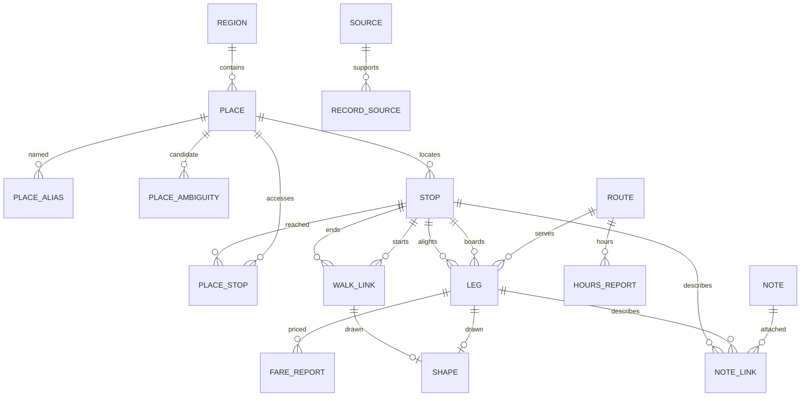

# System Design: Pusang Gala

**PRD:** [prd-pusang-gala.md](prd-pusang-gala.md)

**Implementation ownership:** [TODO.md](TODO.md)

The owner confirmed the product scope in G01–G27. This design is reconciled with that scope and remains Draft because no scaffold, device benchmark or runtime integration has been implemented. The tables below are the shared proposed contracts; members settle and version them in task T00 before dependent implementation. Do not add deferred functionality.

## 1. Architecture

The judged Android APK uses React Native + an Expo development build, local SQLite facts, MapLibre, foreground location and a strictly sub-1B model through a tested native runtime. The required answer pipeline is **offline retrieval + deterministic rules → cards → streamed grounded local-AI explanation**.

### 1.1 Data and runtime paths

```text
OFF-DEVICE BUILD
Supplied ncr_routes.json + snapshot hash
    -> audit/classify all 2,186 posts with stored comments
    -> automated structured extraction + paraphrased notes
    -> second AI pass: evidence and inconsistencies
    -> ambiguous connections/incomplete instructions -> team review
    -> normalize places + NCR membership + coordinate evidence
    -> validate supported legs, walks, fare scope, status and provenance
    -> pack.sqlite + manifest + yield/rejection/review report

Licensed basemap -> NCR extract + local style/glyphs/sprites + attribution
Selected sub-1B model -> pinned model + licence + checksum

ON-DEVICE, NO NETWORK
Query + current-trip structured state
    -> normalize / local intent understanding
    -> place resolution -> clarification or outside-NCR/no-data
    -> retrieve eligible structured facts + relevant paraphrased notes
    -> rule-based route search and validation
    -> deterministic cards + comparison reasons + source/warning context
    -> bounded evidence bundle
    -> local AI -> validated explanation units -> streamed response

Cards/route -> schematic + local map + foreground GPS
Selected record IDs/manual step -> user.sqlite -> checked restoration
```

Raw repository comments never enter the runtime pack or runtime prompts. There is no account module, Firebase dependency, API server, telemetry or cloud fallback in this release.

### 1.2 Corpus audit and extraction

For the supplied snapshot at commit `3732824`:

| Input | Posts | With stored comments | Without stored comments | Stored comment texts |
|-------|-------|----------------------|-------------------------|----------------------|
| routes.json | 16,387 | 8,556 | 7,831 | 15,350 |
| ncr_routes.json | 3,480 | 2,186 | 1,294 | 3,988 |

The NCR JSON has post IDs, title/question, post timestamp, score, comment-count metadata, permalink, free-text origin/destination and comments containing only score/text. There are no structured stops, ride legs, fares, coordinates, paths, comment IDs, comment dates or reply-parent relationships.

Use JSON as extraction input. NCR CSV includes unanswered posts, and some top answers are acknowledgements, incomplete or truncated. Do not use highest score as a correctness rule. The README's answer totals differ slightly from actual stored-array totals; the extraction report recomputes counts.

An input labelled NCR may still identify an outside-NCR endpoint. Canonicalize places and establish NCR membership through geography evidence. A map rectangle is an asset extent, not an administrative-boundary test.

Build stages:

1. Hash the input and audit actual arrays. Assign stable evidence locators using post ID, comment index and snapshot hash; indexes are snapshot-specific, not Reddit comment IDs.
2. Classify text into useful route evidence, follow-up question, acknowledgement or unrelated content. Missing/deleted question text can still coexist with useful comments, but cannot be reconstructed by guessing.
3. Extract candidate places, directed ride segments, explicit walk/transfer instructions, fare reports, hours, service-status reports and paraphrased notes. Keep extraction uncertainty.
4. Run a second AI pass against the original evidence. It flags unsupported claims, inconsistent endpoints, incomplete connections and conflicting reports; it is not field verification.
5. Queue ambiguous connections/incomplete instructions for the designated team member. Preserve conflicting fare/hour reports with source references. Unresolved route-critical facts are quarantined.
6. Map places using permitted geographic evidence. Keep coordinate uncertainty separate from route-text eligibility. Unknown coordinates do not become guessed points.
7. Validate, build the pack and emit processed/included/filtered/review-pending/rejected post counts plus record and coverage counts. A post may produce zero or several facts; it is not an itinerary count.

Off-device extraction intermediates have an explicit proposed JSON contract: `candidate_id`, `snapshot_sha256`, `post_id`, `comment_index`, `record_kind`, `candidate_payload`, `evidence_check`, `review_reason`, `review_state`, `reviewer_id`, `reviewed_at`. States are `extracted|second_passed|needs_review|accepted|rejected`. `second_passed` means eligible only if deterministic checks pass and no required human review remains. The pack omits raw wording and intermediate reviewer details.

### 1.3 Retrieval and rule-based routing

SQLite exact aliases, FTS and typo ranking provide the initial local retrieval strategy. RAG does not require embeddings: retrieved structured facts and relevant paraphrases supply the context used to generate the answer. Add semantic indexing only if measured retrieval failures justify it and it fits the device budget.

- Exact aliases are tried first. Known ambiguous aliases or low candidate margins always return clarification. Current-trip references resolve from structured state, not invented names.
- Both resolved endpoints require accepted NCR membership and source-backed place-to-stop access. Geographic proximity cannot create a first/last walk or transfer.
- Each LEG is a source-supported directed boarding-to-alighting ride segment. WALK_LINK and PLACE_STOP carry explicit supported walking instructions. Transfer joins require supported relationships; cross-thread joins are allowed.
- Multi-criteria label search tracks fare known/unknown, ride count, walk distance known/unknown, reported time known/unknown, current service and visited state. Never represent unknown cost or time as zero for ranking.
- A ride segment represents one boarding. Same-service fragments are not silently stitched or charged as separate boardings; use a source-supported through-segment or an explicit reboarding connection. Fare reports apply only to their recorded segment.
- Output may include alternative complete itineraries. Compare only applicable known values and state the comparison set. Unknown-value alternatives remain visible, with no guaranteed cheapest/fastest claim.
- Source-conflicted values stay as separate dated reports. Do not average contradictions into a fabricated fact. Derived totals/ranges require complete applicable inputs; otherwise total is unknown.
- Filter suspended/retired services and unresolved records. If continuity fails, return no complete itinerary.
- Report operating hours only when source-backed. Unknown hours stay unknown; there is no timetable scheduler, guaranteed current availability or arrival prediction.

### 1.4 Conversation and grounded streaming

The current-trip session holds canonical endpoint IDs, preference, selected itinerary IDs, manual step, pending clarification and a bounded in-memory exchange window. Follow-ups can change destination/preference, request alternatives/reverse journeys, or ask about boarding, fares, transfers and reported hours. New-trip clears context. Reverse requests rerun directed routing.

The evidence bundle contains the canonical cards, eligible record IDs, relevant paraphrased notes, explicit unknown/conflict/age flags, source references, rule-produced comparison/hour statements and the current-trip state. Bound its size; retrieve relevant records rather than feeding the whole NCR corpus.

**Required streaming contract:** the model emits constrained explanation units with a reply kind, optional canonical card reference and supported explanation content. The exact JSON/GBNF schema and output cap are settled in T00/T30. Canonical factual inserts and route sequence come from the card composer; free-text generation cannot author boarding, alighting or transfer instructions. Rule-produced reason/hour statements supply factual explanations.

Buffer a complete unit, validate its card references, factual inserts and meaning against the evidence, then emit it. Never display unchecked native tokens and try to correct them afterwards. A vocabulary allowlist is insufficient: a model can reverse instructions using allowed names. Adversarial and semantic review must cover that case.

Cards appear immediately after rules finish. Accepted explanation units stream afterwards, with cancellation, retry and a visible inference-failure state that preserves cards. Initial full warm-explanation target is 10 seconds; measure intent, first safe unit, full response and cold load separately. A template fallback handles transient failures and unsupported phones; it cannot replace working reference-phone AI for release.

### 1.5 Model and device policy

The reference-device profile is 4 GB RAM / 64 GB storage, MediaTek Helio-class; exact model/ABI/Android version must be recorded. Do not advertise a minimum Android version or 32-bit compatibility until the selected Expo/native build is tested.

Model candidates carried forward for measurement include Qwen3-0.6B, Qwen2.5-0.5B-Instruct, LFM2-350M/700M and Gemma 3 270M. Confirm actual parameter counts, supported GGUF/runtime format, current licence and distribution permission before pinning. No candidate is the release winner yet.

Use CPU inference as the initial budget-phone baseline. Benchmark quantization, thread count and context size on the actual phone; historical Q4_0/1,024-context assumptions do not establish performance for conversational RAG. Keep one model context and one generation at a time, cancel stale requests, and release native context on memory pressure/idle/background as measured.

| Capability | Behaviour |
|------------|-----------|
| Reference phone | Required intent/conversation AI plus all other required features; passing the release gates is mandatory |
| Supported but constrained phone | Reduce generation/context budgets if measured usable; retain maps/cards/manual input |
| Unsupported ABI/RAM/model failure | Explain AI unavailability; retain other usable features without cloud fallback |
| Temporary inference error | Preserve cards/trip, show retry/cancel, record local diagnostic only |

Provisional peak PSS budget is 1 GB on the 4 GB phone. Validate map/GPS/model together rather than proving each in isolation.

### 1.6 Map, GPS and assets

Use MapLibre with a local NCR basemap, style, glyphs and sprites. Test `pmtiles://file://` support in the selected native version; if unsupported, evaluate a tested local MBTiles/offline-region path. No network tile/style/font fallback is permitted. Basemap extraction extent may include a small border for tiles; endpoint eligibility remains strictly NCR.

Map points require coordinate evidence and an accepted mapping state. Unmapped points remain in cards/schematic and are identified as unmapped. Schematic connections are dashed and labelled not to scale; actual vehicle paths require source-backed geometry. An OSM road path is not automatically a transit service path.

Use one foreground Expo Location subscription during an active trip. GPS fixes live in memory and expose accuracy/fix age. Supported mapped origins may be suggested when the fix is suitable, but require confirmation. Denied permission/no fix preserves manual input. Background/end-trip pauses tracking. Manual steps, no recorded trace or automatic detection.

The judged APK embeds the model, pack, map and all rendering dependencies. Locate/copy to native-readable paths as required and check SHA-256/schema before use. Record footprint including APK and duplicated copies; previous regional map-size estimates do not describe the new NCR package. Pack/map updates may use app replacement; OTA and Play asset delivery are later distribution work.

## 2. Components and ownership

Paths are proposed; none exists yet.

| Component | Responsibility | PRD | Lead |
|-----------|---------------|-----|------|
| Corpus audit/extractor/review | Classify, extract, second-pass evidence, resolve queue | F10, F11 | Member 1 |
| Pack builder | Validate records/provenance, build SQLite/manifest/yield report | F10 | Member 1 |
| Normalizer/intent contracts/place resolver | Shared text and alias logic; clarify NCR places | F1, F2, F19 | Member 2 |
| Graph/router/validators | Supported connections, exclusions, fare scope and qualified ranking | F3, F20 | Member 2 |
| Card composer/RAG evidence builder | Deterministic facts, warnings, relevant bounded retrieval context | F4, F11, F12 | Member 2 |
| Native model adapter/device capability | Pin/model benchmark, load/cancel, constrained output | F1, F5, F8 | Member 3 |
| Conversation manager/stream guard | Trip follow-ups, bounded memory, safe streaming | F5, F19, F20 | Member 3 |
| Expo app/asset and pack loader | Native build, local paths, schema/hash/readiness | F8, F9 | Member 4 |
| Map/location/schematic | Offline basemap, supported points, GPS lifecycle, manual steps | F6, F7, F12 | Member 4 |
| User store/restore | Saved/history/active IDs and compatibility checks | F15, F21 | Member 4 |
| Integration/app screens/release | Functional integration before visual design, device evidence | All required | Member 4, all members validate |
| Core evaluation fixtures | Route, ambiguity and evidence assertions | F1–F4, F10, F20 | Member 2 |
| Conversation evaluation | Held-out follow-ups, grounding and stream failures | F5, F19 | Member 3 |

## 3. Data model

There is no implemented schema. Agree this proposed schema in T00, then create versioned migrations and shared TypeScript contracts. No legacy `verified` or `last_verified` state is used as a publication requirement. Contracts v1 are recorded in [contracts-pusang-gala.md](contracts-pusang-gala.md) and implemented in `packages/core/src/schema` and `packages/core/src/contracts`.

### 3.1 Pack relationships



### 3.2 Proposed pack entities

SQL types below are `text`, `integer` or `real`. IDs are stable text unless specified. “?” means nullable. Every factual record has RECORD_SOURCE evidence, including coordinates and geometry where present.

| Entity | Columns and meaning |
|--------|---------------------|
| REGION | `region_id:text PK`, `name:text`, `boundary_geojson:text`, `boundary_sha256:text`; NCR administrative boundary with source evidence |
| PLACE | `place_id:text PK`, `region_id:text FK`, `name:text`, `kind:text`, `area:text`, `ncr_status:text` (accepted/ambiguous/outside), `lat:real?`, `lng:real?`, `mapping_status:text` (mapped/unmapped/needs_review) |
| PLACE_ALIAS | `alias_id:integer PK`, `place_id:text FK`, `alias_norm:text UNIQUE`, `alias_display:text` |
| PLACE_AMBIGUITY | `ambiguity_id:integer PK`, `alias_norm:text`, `place_id:text FK`; at least two candidates for an ambiguous alias |
| STOP | `stop_id:text PK`, `place_id:text FK`, `name:text`, `landmark_hint:text`; inherits accepted coordinate evidence from PLACE |
| PLACE_STOP | `access_id:text PK`, `place_id:text FK`, `stop_id:text FK`, `direction:text` (to_stop/from_stop/both), `walk_m:integer?`, `walk_min:integer?`, `walk_text:text`, `eligibility:text` (ready/excluded) |
| ROUTE | `route_id:text PK`, `mode:text` (jeepney/modern_jeepney/uv_express/bus/tricycle/rail), `signboard:text?`, `direction_label:text`, `service_status:text` (reported_active/unknown/suspended/retired) |
| LEG | `leg_id:text PK`, `route_id:text FK`, `board_stop_id:text FK`, `alight_stop_id:text FK`, `ride_min:integer?`, `dist_km:real?`, `eligibility:text` (ready/excluded); one supported boarding-to-alighting segment |
| WALK_LINK | `walk_id:text PK`, `from_stop_id:text FK`, `to_stop_id:text FK`, `walk_m:integer?`, `walk_min:integer?`, `walk_text:text`, `eligibility:text` (ready/excluded); explicit directed transfer |
| FARE_REPORT | `fare_id:text PK`, `leg_id:text FK`, `amount_min:real`, `amount_max:real`, `currency:text`, `basis:text` (reported_segment), `effective_at:text?`; separate conflicting reports; no row means unknown |
| HOURS_REPORT | `hours_id:text PK`, `route_id:text FK`, `hours_text:text`, `starts_local:text?`, `ends_local:text?`, `days_text:text?`; reported hours, not a timetable |
| SHAPE | `shape_id:text PK`, `leg_id:text FK?`, `walk_id:text FK?`, `geojson:text`, `geometry_kind:text` (source_path/schematic); exactly one owner, source_path requires geometry evidence |
| NOTE | `note_id:text PK`, `body:text`, `kind:text` (tip/warning/conflict); paraphrased |
| NOTE_LINK | `link_id:integer PK`, `note_id:text FK`, `leg_id:text FK?`, `stop_id:text FK?`; exactly one owner |
| SOURCE | `source_id:text PK`, `kind:text` (reddit_thread/geography/team_review/licensed_data), `url:text?`, `post_id:text?`, `posted_at:text?`, `observed_at:text?`, `license:text?`; observed_at only when the evidence explicitly supplies it |
| RECORD_SOURCE | `link_id:integer PK`, `record_kind:text`, `record_id:text`, `source_id:text FK`, `snapshot_sha256:text?`, `comment_index:integer?`; locate source evidence without shipping raw text |
| PACK_MANIFEST | `pack_id:text PK`, `schema_version:integer`, `region_id:text FK`, `bbox:text`, `created_at:text`, `source_date_min:text?`, `source_date_max:text?`, `stale_after_days:integer`, `input_sha256:text`, `input_posts:integer`, `answered_posts:integer`, `included_posts:integer`, `filtered_posts:integer`, `pending_posts:integer`, `rejected_posts:integer`; one row, initial warning threshold 180 days |

The manifest's post-disposition counts are mutually exclusive final per-post outcomes and sum to `answered_posts`; store detailed per-record outcomes in the off-device report. Declare disposition precedence in the builder for posts producing both included and rejected candidates. Count actual usable records separately in the report.

A companion manifest records the output `pack_sha256` and asset sizes. Hash the finished SQLite file externally; do not store a self-referential file checksum inside that same file.

### 3.3 User entities and session state

| Entity | Proposed columns | Retention |
|--------|------------------|-----------|
| USER_SETTING | `key:text PK`, `value:text` | Until changed/uninstall |
| ACTIVE_TRIP | `trip_id:integer PK`, `pack_id:text`, `schema_version:integer`, `origin_place_id:text`, `destination_place_id:text`, `preference:text`, `route_json:text` (record IDs only), `current_step:integer`, `started_at:text` | One row until end-trip; survives process death |
| SAVED_ROUTE | `saved_id:text PK`, `pack_id:text`, `origin_place_id:text`, `destination_place_id:text`, `preference:text`, `route_json:text` (IDs), `label:text?`, `created_at:text` | Until user deletion |
| TRIP_HISTORY | `history_id:text PK`, `pack_id:text`, `origin_place_id:text`, `destination_place_id:text`, `preference:text`, `route_json:text` (IDs), `kind:text` (looked_up/taken), `at:text` | Until user deletion |
| INSTALLED_ASSET | `asset_id:text PK`, `kind:text` (model/pack/map), `file_path:text`, `version:text`, `sha256:text`, `bytes:integer`, `state:text` (missing/verifying/ready/failed), `license:text` | Until replacement/uninstall |

No raw query/chat, GPS coordinates, GPS trace, Firebase UID or cloud-sync columns exist in user.sqlite. Labels are user-authored names, not copied query transcripts. Model conversation text and fixes remain in memory; restoration reconstructs context from canonical route IDs and the manual step, not a saved chat transcript.

### 3.4 Validation and replacement

- Source date is not verification date. Conflicting fare/hour reports remain distinct; staleness derives from their source evidence dates with clearly named labels.
- Ready records require supported endpoints and instructions, accepted NCR membership, source links and resolved route-critical review. Excluded/unresolved records cannot load into the graph.
- No outside-NCR endpoint is routed. Coordinate evidence is nullable; missing coordinates do not block a supported text route but cannot become a map marker/GPS suggestion.
- Walk/access/geometry records require their own evidence. Do not create access by nearest-stop distance.
- Unique alias_norm belongs to PLACE_ALIAS only for unambiguous aliases; ambiguous aliases use PLACE_AMBIGUITY.
- Foreign keys, paired nullable coordinates, amount_min ≤ amount_max, nonnegative known durations and exactly-one-owner links are checked in the builder and loader.
- Persist pack IDs and stable record IDs. After replacement, revalidate existence, status, connection order and manual-step bounds; unknown schema or changed records trigger replanning.
- Pack schema changes replace the read-only DB; user DB migrations are forward-only numbered transactions. These schemas are not implemented yet.

## 4. Internal API surface

All calls are in-process. No runtime network API exists.

| Contract | Result/purpose |
|----------|----------------|
| `core.parse(query, tripState)` | Structured intent/endpoints/preferences or clarification; rule baseline |
| `ai.extractIntent(query, tripState)` | Constrained intent fallback, cancellable; no route facts |
| `core.resolve(text, pack)` | Resolved / NeedsClarification / Unsupported / OutsideNcr |
| `core.retrieve(intent, pack)` | Eligible route facts, relevant notes and evidence IDs |
| `core.route(origin, destination, preference, facts)` | Complete alternatives with qualified comparisons, or NoRoute |
| `core.compose(itinerary, pack)` | Canonical cards, source-date/conflict/unknown flags |
| `core.buildContext(cards, notes, tripState)` | Bounded RAG evidence bundle with allowed references |
| `ai.explain(context, onSafeUnit)` | Guarded streaming explanation; cancel/retry without changing cards |
| `trip.advanceStep() / reset()` | Manual journey progression and session reset |
| `trip.restore(pack)` | Valid reconstructed trip or NeedsReplan |
| `setup.locateAssets()` | Schema/hash/readiness states; local files only |
| `location.start() / stop()` | In-memory foreground fix stream and lifecycle cleanup |

Member 2 owns core/result contracts; Member 3 owns intent/explanation-unit contracts; Member 1 owns evidence/pack contracts; Member 4 owns native and persistence adapters. T00 and PR review resolve their shared interfaces before merging dependent changes.

## 5. Cross-cutting concerns

| Concern | Approach |
|---------|----------|
| Network | Runtime core has no fetch/XHR/WebSocket/cloud SDK path. Audit native map/style sources as well as JS imports. External source links require an explicit user action and are not needed to use the app. |
| Privacy | No uploads/telemetry; no raw chat or GPS persistence; foreground permission requested when useful. |
| Validation | Typed result unions and boundary schemas for extracted facts, pack loads, model units and saved-state restoration. |
| Grounding | Facts/cards/context originate in pack IDs; generation cannot create route steps. Validate complete units before streaming, with semantic/adversarial checks. |
| Source content | Explicit asset allowlist excludes `howtogetthereph_dataset/`, `data/raw/` and review intermediates from the APK. Scan shipped assets and training inputs, not the intentionally supplied raw input directory. |
| Licensing | Record redistribution basis/attribution for data, basemap, model and fonts before bundling. Extraction/paraphrasing does not itself establish permission. |
| Memory/storage | One inference at a time; bounded context; native file loading, no model base64 in JS; measure concurrent peak and installed asset duplication. |
| Diagnostics | Local counters/timings without transcripts or coordinates. No analytics/crash-reporting service. |
| Workflow | Always create a task branch and PR. Require another member's review; shared-contract changes have dependent-owner review. See TODO §2. |

### 5.1 Invariant enforcement

| INV | Enforcement | Planned negative checks |
|-----|-------------|------------------------|
| INV-1 | Extractor evidence checks, pack builder, route continuity, canonical cards, RAG/stream guard | Fabricated leg/transfer, reversed boarding, unsupported factual insert, disconnected endpoints |
| INV-2 | Import boundary, network guard, native local asset configuration | Block runtime network, force-stop/cold-launch airplane-mode app with all required flows |
| INV-3 | User schema, in-memory conversation/fix state, dependency allowlist | Raw chat/coordinate fields in user DB, location subscription after background/end-trip, upload/telemetry dependency |
| INV-4 | Builder/training scanner and APK asset allowlist | Raw comment/user mention leaked into a note/training sample or packaged dataset |
| INV-5 | Report labels, unknown/conflict-aware ranking, status filters, fix age | Missing fare coerced to zero, source date called verified, suspended service, stale fix without label |
| INV-6 | Alias ambiguity/result contracts and origin confirmation | Ambiguous alias auto-pick, automatic GPS origin selection |
| INV-7 | Placeholder-only optional training generation | Real pack stop/signboard/fare in fine-tuning examples |

Checks are planned, not implemented or passed.

## 6. Feature-to-design map

| PRD-F# | Components |
|--------|------------|
| F1 | Normalizer, intent rules/native adapter, evaluation |
| F2 | Resolver, canonical geography, clarification |
| F3 | Graph/router, continuity/status/fare validators |
| F4 | Card composer, record sources, warning labels |
| F5 | Required model, RAG evidence bundle, explanation-unit guard |
| F6 | Map pack, local renderer, coordinate/shape evidence |
| F7 | Foreground location, origin confirmation, fix-age labels |
| F8 | Asset installer/pack loader and readiness |
| F9 | Typed failure reasons and recovery UI |
| F10 | Corpus pipeline, review queue, pack builder/yield report |
| F11 | Paraphrased note store/retriever |
| F12 | Ordered schematic renderer |
| F15 | User store/saved/history revalidation |
| F19 | Current-trip conversation manager and follow-up retrieval |
| F20 | Hours reports and grounded unknown/time responses |
| F21 | Active-trip store and compatibility-aware restore |

Deferred F13/F14/F16–F18 have no current implementation components.

## 7. Superseded alternatives and boundaries

The original Flutter/1.5B/vector/Google-handoff architecture is historical evidence. A model at or above 1B is ineligible regardless of quantization. Google Maps data is not a source. Raw-comment runtime RAG, model-written route steps, template-only reference-phone AI, automatic proximity transfers and a field-verified badge contradict the confirmed scope.

Embedding/vector retrieval and fine-tuning remain measured engineering options, not release dependencies. A baseline local retrieval strategy and zero-shot model should be evaluated before adding them. No account/backend/Play-delivery spike belongs in the current critical path.

## 8. Execution prerequisites

Assign actual member names and a corpus reviewer; record the exact reference phone; settle T00 shared schema/result contracts; measure native compatibility, local-map format and grounded generation. Technical unknowns are tracked in LOG and TODO, with owners and dependencies. They do not reopen the agreed product boundary.

## 9. Feasibility and release gates

| Gate | Question | Pass/evidence | Lead |
|------|----------|---------------|------|
| S1 | Can the selected Expo/RN/runtime build load and run a sub-1B model offline on the actual phone? | Named versions/model hash; constrained output; 20 runs without crash/OOM; reference AI works | Member 3 + Member 4 |
| S2 | Can the selected MapLibre build render local NCR tiles/style/glyphs/sprites? | Cold airplane-mode launch with labels/attribution; tested fallback if local PMTiles unsupported | Member 4 |
| S3 | Does foreground GPS work offline with the map mounted? | Outdoor fixes, age/accuracy, denied/no-fix handling, lifecycle cleanup and confirmation | Member 4 |
| S4 | Do map/GPS/streamed inference fit concurrently? | Peak PSS/installed footprint; 20-query lifecycle run; background/restart recovery; unsupported-device fallback | Member 4 + Member 3 |
| S5 | Which eligible model best handles intent and grounded follow-ups? | Held-out accuracy, unsupported claims, first-safe/full warm latency ≤10-second initial target, cold load and memory; choose only a model passing required conversation | Member 3 + Member 2 |
| S6 | Does the complete corpus pipeline produce an auditable eligible pack? | All 2,186 inputs attempted; disposition counts; provenance; unresolved joins quarantined; no raw wording in runtime assets | Member 1 + Member 2 |
| S7 | Does integration work beyond demonstration examples? | Unseen supported queries, follow-ups, qualified alternatives, source warnings, save/restore, cold offline map/GPS/AI; all PRD Must-Haves | All four members |

Optional fine-tuning is considered only after S5 identifies a measured deficiency; use placeholder-only data, no raw Reddit or real route facts. The app cannot be released as rules-only on the judging reference phone.
